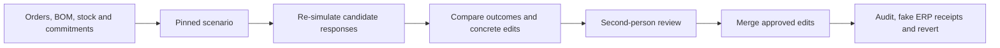

# OntoAct

A decision workbench for material shortages: trace affected orders, compare feasible responses, and apply reviewed changes with an audit trail.

[中文](README_zh.md) · [Demo walkthrough](docs/showcase/DEMO.md) · [Engineering decisions](docs/showcase/ENGINEERING.md) · [Verification](docs/showcase/VERIFICATION.md)

A delayed component can affect several products and compete for the same inventory. OntoAct links orders, BOMs, stock, supply commitments and production capacity, then re-simulates candidate responses against the same baseline. A selected response becomes a Decision Package: another user reviews it before it can change live objects.

The main example uses **synthetic manufacturing data**. The procurement connector is a **local fake ERP**. Reported amounts below are known answers for this fixture, not customer savings or measured production impact.

## A concrete result

The fixture has 12 orders, a multi-level BOM, reserved stock, expiring supply commitments and two production lines. Its baseline has **550,000 in revenue at risk**.

| Response | Revenue still at risk | Incremental cost | Trade-off |
|---|---:|---:|---|
| Expedite the delayed commitment | 140,000 | 3,200 | Three late orders recover; one remains blocked |
| Buy qualified alternate stock | 480,000 | 520 | Recovers one order |
| Reallocate scarce stock | 420,000 | 0 | Helps two orders but harms two others |
| Buy from an unqualified supplier | 140,000 | 880 | Rejected by a hard qualification constraint |
| Expedite + qualified alternate + line reassignment | 0 | 3,720 | All four at-risk orders recover |

These results are checked against [hand-derived expected allocations and costs](backend/unit_tests/test_l3harris_known_answer.py). Candidates use a bounded deterministic heuristic; they are not claimed to be globally optimal.



## What to inspect

- **Allocation correctness:** [calculation](backend/app/services/v2/material_shortage.py) and [counterexamples](backend/unit_tests/test_material_shortage_decision.py). Failed orders release tentative allocations; shared material cannot be allocated twice.
- **Reviewed changes:** [Decision Package transitions](backend/app/services/v2/decision_packages.py) and [API tests](backend/tests/test_material_decision_package_flow.py). Self-review, stale versions and repeated requests have explicit behavior.
- **Actual application of a plan:** [real-FalkorDB apply/revert acceptance](backend/tests/v2/test_material_decision_apply_real_falkor.py). It checks that re-running after application reproduces the predicted outcome.
- **Model boundaries:** [evidence-linked explanations](backend/app/services/v2/decision_explanations.py) are optional commentary. Numeric occurrence and citation checks do not establish semantic truth. Models do not approve or directly apply changes.

## Run the decision demo

Requires Git, Docker Compose **2.24.4+** (the local overlay uses `!override`), and Bash. On Windows, use WSL or Git Bash. The full stack builds several services; resource requirements and cold-start time have not yet been measured on a clean machine.

From the checkout containing this README:

```bash
bash scripts/bootstrap_deployment.sh --seed-decision-demo
```

The command enables JWT for the local stack, creates separate author/reviewer demo accounts, seeds a fresh object-backed study, waits for its baseline, and checks the known-answer totals. It stores the link and generated credentials in **`.decision-demo.json`**, a local private file excluded from Git. Each invocation creates a fresh demo; it does not reset existing ontologies.

1. Open `.decision-demo.json` locally and sign in as its **author**.
2. Open its `url`, inspect the blocked orders and compare the candidates.
3. Select the combined response, inspect its edits and submit a Decision Package.
4. Sign out, sign in as the **reviewer**, open the same URL and approve the package.
5. Apply it, reload to inspect the persisted result and receipts, then revert. Supplier notifications are listed separately because restoring object state cannot unsend an external effect.

No model key is needed for this calculation/review/apply flow. Optional model explanations require `OPENAI_API_KEY`. The [walkthrough](docs/showcase/DEMO.md) covers service checks, repeat runs and limitations.

For a broader single-user exploration with the public frePPLe fixture, use `bash scripts/bootstrap_deployment.sh --seed-demo`. That mode cannot demonstrate second-person approval from the same identity.

## Architecture and boundaries

| Component | Purpose |
|---|---|
| React / TypeScript | Object inspection, candidate comparison and review UI |
| FastAPI / Pydantic | Request contracts, authorization and application orchestration |
| PostgreSQL | Revisions, policies, facts and execution records |
| FalkorDB | Graph projection and object traversal |
| Celery / Redis | Background studies and scheduled work |
| Separate Python runner | User Functions with process limits and a read-only container |

The broader platform also includes data connectors, ontology modeling, temporal replay and other examples. Those live in the [platform reference](docs/showcase/PLATFORM_REFERENCE.md); they are outside the main decision walkthrough. Neo4j, vector storage and the model gateway remain in the current full Compose topology, including services the main demo does not need.

Current limits:

- This is a development/demo deployment. Legacy endpoints are not all migrated to the unified authorization projection; it is not ready for shared production use.
- The legacy natural-language Cypher execution endpoint returns **410**. It is retired until a policy-aware query path can enforce its permissions and query bounds.
- Model prose is **semantically unverified**, including its summary. Matching a number to evidence does not validate its meaning, direction, units or entity attribution.
- Runner isolation limits filesystem writes, child processes, execution time and buffered output. Its internal network is shared with backend/worker services; this is not an adversarial multi-tenant execution service.
- No published retrieval-quality improvement, production throughput, customer savings or causal maintenance prediction is claimed.

## Verify

Python 3.12; Node.js 22. Use an isolated Python environment.

```bash
cd backend
pip install -r requirements.txt
python -m pytest unit_tests -q

cd ../frontend
npm ci
npm run lint:src
npm run build
```

[CI](.github/workflows/verify.yml) defines separate unit, frontend and real PostgreSQL/FalkorDB/runner checks. The integration job rejects skipped tests. The [verification record](docs/showcase/VERIFICATION.md) distinguishes locally executed checks from checks that still require Linux/Docker; a workflow definition is not evidence that a run passed.

Development uses AI assistance. Engineering choices and reviewable boundaries are documented through concrete code, known-answer fixtures and failure tests; generated text is not treated as verification. See [three engineering decisions](docs/showcase/ENGINEERING.md).

[MIT license](LICENSE). Third-party datasets and reference materials retain their own terms.
