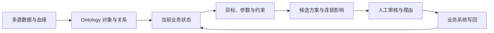

# Palantir NHS 供应链视频：情景推理 UI、用例与本项目差距

> 审计日期：2026-10-18  
> 来源：[Securing the Supply Chain with Palantir Foundry](https://www.youtube.com/watch?v=lKOU7LPsaC4)，Palantir，10:17，2021-12-10  
> 审计范围：只分析与 Ontology 支撑的情景推理直接相关的功能；AIP、通用宣传和独立应用不进入建设建议。  
> 证据边界：视频中的产品画面注明为简化的概念性展示。本报告区分“画面可见”“旁白声明”和“本项目推断”，不把概念演示当作完整产品契约。

## 1. 一句话理解这个 Demo

它演示的不是一个孤立的图或看板，而是一条闭环：把异构数据整理成有业务语义的对象网络，在同一个决策界面调整目标、资源和约束，预演每个动作的连锁影响，选择方案后交给人工审批，最后才写回业务系统。



视频的核心业务问题是：在疫苗供应、站点、人员、耗材、PPE、冷链能力和不同人群优先级都有限的情况下，怎样分配库存，才能尽快、公平地覆盖最脆弱人群并提高利用率。

## 2. 按时间线拆解功能证据

| 时间 | 画面或旁白展示 | UI / 功能设计细节 | 解决的业务问题 | 证据等级 |
|---|---|---|---|---|
| 04:34–04:52 | 数据管道和血缘 | 大画布、按数据域着色、远景总览和局部追踪 | 数据来自数百个来源，出错时要知道哪条链路影响业务决策 | 画面 + 旁白 |
| 04:53–05:25 | Ontology 网络 | 对象类型颜色图例、可缩放关系图、选择局部对象后聚焦上下游 | 把批次、供应商、站点、配送、剂量和接种事件连成可导航的业务网络 | 画面 + 旁白 |
| 05:34–05:47 | 自动检查、告警、故障定位 | 血缘图用于从异常节点沿数据流回溯 | 避免错误输入静默进入分配模型，缩短定位与修复时间 | 主要为旁白；图可见 |
| 05:49–06:20 | 数据最小化、用途限制、问责与访问控制 | 数据按职责与用途受控，分析使用匿名聚合 | 医疗数据不能因“做情景分析”而绕开权限和隐私边界 | 旁白；少量概念画面 |
| 06:25–06:51 | 分配目标与提交前建模 | 先模拟再承诺，查看依赖和 knock-on effects | 防止局部增加剂量后才发现站点、人员或 PPE 不足 | 旁白 |
| 06:50–07:15 | Vaccination Command Centre | 顶部 KPI、目标队列、堆叠容量条、区域需求、库存预测、地图、告警集中在一屏 | 同时判断进度、需求、净产能、覆盖差异和约束瓶颈 | 画面 + 旁白 |
| 07:15–07:39 | 调整策略并观察连锁影响 | 左侧用滑杆和分段控件调整 cohort、渠道、耗材、PPE、冷链；中心指标与告警随之变化 | “多给 GP 分配剂量”会额外消耗多少 PPE，是否仍可行 | 画面 + 旁白 |
| 07:40–07:58 | 提交审核、批准后写回、保留理由 | 旁白说明 submit → reviewers/approvers → operational systems，并保留 actions 与 rationales | 高风险资源分配不能由建模者直接落地，需要职责分离与审计 | **旁白声明；未展示完整审核 UI** |
| 08:04–08:36 | 多个业务应用共享底座 | 订购、配送、uptake 和 scenario model 围绕同一对象语义工作 | 避免每个工具复制一份不一致的数据和业务定义 | 旁白 + 概览画面 |

## 3. 关键截图与设计观察

截图只保留用于界面与功能分析的必要画面；本地视频原文件不应提交仓库。

### 3.1 Ontology 是可操作的业务对象网络


画面先给全局关系，再允许缩放到局部对象。右侧图例使用对象类型及数量，节点颜色表达业务类别。它解决的是“某个疫苗批次与哪些供应商、站点、配送和接种事件有关”，而不是只画模型计算步骤。


局部视图保留一跳及关键多跳关系，并让对象卡片成为导航入口。对本项目的启示是：`StudyGraphCanvas` 的计算 DAG 与业务对象影响图应明确分开；前者回答“怎么算”，后者回答“影响谁”。

### 3.2 Command Centre 将目标、参数、状态与风险放在同一决策面


界面有清楚的阅读顺序：顶部是结果 KPI；左侧是可以改变的决策变量；中央是总能力及分项能力；右侧是需求、库存和告警；下方用于地域或群体差异。用户不需要先理解节点类型或 JSON 才能回答业务问题。


“净系统产能”被拆为站点、人员、耗材、剂量和 PPE，各列同时表达已用、未用和新增需求。这比单一 `feasible=true/false` 更有解释力：用户能看到是哪种资源先成为瓶颈。

### 3.3 修改一个动作时，系统暴露连锁影响


用例是把更多剂量转给 GP 以覆盖更多 NHS 员工。左侧既包含目标人群，也包含渠道比例和 push factors；右侧立刻出现站点容量、耗材、覆盖和准备度告警。参数控件与输出必须有业务单位、边界、当前值及目标含义。


视频用动画说明 Workforce、Doses、PPE 之间的耦合。可测试的产品要求应是：每个候选变更返回约束余量、受影响对象、指标 delta 和原因路径，而不只是重新计算总数。

### 3.4 审批和写回在视频中是声明，不是完整 UI 证据


此帧仍是 Command Centre；没有显示 reviewer 列表、审批状态、评论、拒绝、冲突或写回回执。因此可以借鉴“提交前模拟、批准后执行”的流程，但不能根据该视频 1:1 推断审批页面长相。

## 4. Demo 中的用例，以及每项功能解决的问题

### 用例 A：疫苗库存如何分配

**输入**：库存、不同疫苗/批次、配送能力、站点能力、人员、耗材、PPE、冷链、目标人群、地区需求。  
**目标**：提高利用率和覆盖速度，同时优先覆盖脆弱群体并减少地区或群体不平等。  
**功能作用**：Ontology 统一对象和关系；Command Centre 汇总当前状态；情景参数产生候选分配；模型验证所有约束；比较输出呈现覆盖、利用率和风险变化。

### 用例 B：增加 GP 渠道能否覆盖更多 NHS 员工

**动作**：提高经 GP 路径分发的剂量比例。  
**直接效果**：目标群体覆盖增加。  
**二阶影响**：GP 站点、人员、耗材、PPE 和冷链需求增加。  
**功能作用**：关系图提供影响传播路径；情景引擎重算资源负荷；告警指出约束被突破；用户可以继续增加 PPE 或调整渠道，直到形成可行候选方案。

### 用例 C：上游数据问题会不会污染决策

**事件**：某条源数据或转换管道失败。  
**风险**：库存、需求或站点能力数据过期，模型给出形式上可行但事实上错误的分配。  
**功能作用**：自动质量检查触发告警；血缘图定位上游来源和受影响下游；Scenario Run 应标记数据 freshness、completeness 和 provenance，严重时阻止提交。

### 用例 D：高风险方案怎样安全落地

**动作**：建模者选择一个候选分配并提交。  
**风险**：同一人既修改又批准；审批期间基线已经变化；外部系统部分写入失败。  
**功能作用**：职责分离、不可变决策包、审批意见、提交时冲突重检、幂等写回、回执和补偿/回滚。视频只声明了目标流程，这些是本项目要补齐的工程验收条件。

## 5. 与当前整合分支的真实差距

### 5.1 已满足或已有可靠基础，不应重做

| 能力 | 当前证据 | 判断 |
|---|---|---|
| 可版本化 Study | `ScenarioStudiesPage` 支持草稿、验证、发布和不可变版本 | 保留 |
| Case / Run 分离 | Case 参数覆盖、编译后的 RunPlan、异步 Run、取消和重试已经存在 | 保留 |
| 可拖动计算 DAG | `StudyGraphCanvas` 与 XYFlow 已支持节点布局、端口连线和只读发布视图 | 保留并改进解释 |
| 参数、指标和约束 | Study spec 已定义 parameters、metrics、hard/soft constraints 和预算 | 保留，减少直接 JSON 暴露 |
| 基线与候选比较 | `StudySimulationTable` 支持输入覆盖、结果和相对基线 delta | 保留 |
| 对象查询与情景隔离 | Scenario 固定/跟踪基线、对象浏览、Action preview、merge-preview 已存在 | 保留 |
| 供应/BOM/排程逻辑 | 多级 BOM、替代供应、产能重排、求解器可行/不可行测试已存在 | 作为核心测试素材 |
| 审计和部分审批基础 | 规则 proposal review、防止 self-approval、Action run revert 已有后端能力 | 复用，不另造平行审批系统 |
| 真实规模证据 | 现有实施记录已验证 100k FalkorDB 导入/快照及真实 Docker 链路的一部分 | 作为容量基线，不宣称完整生产 SLO |

### 5.2 最大产品差距

| 优先级 | 差距 | 对用户的影响 | 建议落点 |
|---|---|---|---|
| P0 | Study 定义、对象影响、运行结果、Action 和审批仍像多个工具 | 用户要理解平台内部概念，无法自然完成一次决策 | 新增统一的 **Decision Workspace**，复用现有 API 和组件 |
| P0 | 缺少“一个动作导致哪些二阶影响”的可解释路径 | 指标变了，但业务用户不知道为什么 | Run 结果增加 `impact_paths`：参数/Action → 对象关系 → 资源约束 → 指标 |
| P0 | 方案没有形成可提交的不可变决策包 | 无法证明审核者看到的就是运行过的输入与结果 | 固定 study/version、scenario revision、data view、logic versions、parameters、metrics、constraints、artifacts、rationale 和 digest |
| P0 | Scenario 合并与规则审批尚未串成方案级审批 | 高风险动作只能逐模块操作 | 在现有 rule review、Action preview/commit/revert 上加薄编排层 |
| P1 | Simulation 以表格为主，缺少目标、资源余量和告警的联动布局 | 可比较，但不容易发现瓶颈 | 顶部 KPI + 左侧输入 + 中部 constraint headroom + 右侧 alerts/affected objects |
| P1 | 计算 DAG 与业务对象图概念容易混淆 | 用户会把“函数节点”误认为“供应商/订单节点” | 标签明确为“模型流程”和“业务影响”，使用不同视觉语法 |
| P1 | 约束配置仍暴露 JSON | 非技术业务用户难以编辑单位、范围和规则 | 基于 canonical schema 渲染有类型控件，高级 JSON 仅折叠保留 |
| P1 | 数据血缘健康没有进入 Run 可用性判断 | 使用过期/不完整数据仍可能得到绿色结果 | Run 前检查 freshness/quality/lineage status，输出阻断或降级原因 |
| P2 | 多目标权衡仅有 direction 和 delta，缺少公平性/风险解释 | 无法表达“覆盖更多但不平等加剧” | 支持目标权重、不可妥协约束、Pareto 候选及敏感性分析 |

这里的首要工作不是复制视频的颜色或地图，而是把现有底层能力组成一个可理解、可审核的情景决策闭环。地理空间已按当前项目决定排除，因此地图仅作为视频证据，不进入近期实现范围；群体/区域差异可先用表格和分组图表达。

## 6. 可直接转成后续验收的测试素材

### 6.1 从简单到复杂的业务测试

| 层级 | 测试问题 | 输入变化 | 必须证明的结果 |
|---|---|---|---|
| 1 | 单一供应商停供两天，会缺哪些料？ | supplier availability=0，48h | 只沿真实供应关系和 BOM 传播；无关产品不受影响；给出缺口和证据路径 |
| 2 | 有没有替代来源？ | 加入替代供应商、lead time、MOQ、价格、认证状态 | 未认证替代不得自动采用；容量不足时剩余缺口不能消失 |
| 3 | 订单增加 30%，现有产能能否按期完成？ | demand ×1.3 | 输出可行性、瓶颈资源、延期订单和最早恢复时间 |
| 4 | 批量翻倍会让周期增加多少？ | quantity ×2 | 区分换线固定时间与单件时间；并行资源不能被错误串行化 |
| 5 | 停供 + 多级 BOM + 替代采购 + 排程 | 供应中断、替代容量/交期、订单优先级 | 从供应商到物料、工单、资源和订单形成完整影响路径；比较多个候选方案 |
| 6 | 优先保证关键客户会牺牲什么？ | priority weights 和最低服务约束 | 展示被推迟订单、服务率、成本和软约束代价，不隐藏受损群体 |
| 7 | 方案运行后基线变化 | 审批前库存或订单 revision 改变 | 提交/写回前检测 stale baseline 和冲突，禁止静默应用 |
| 8 | 部分写回失败 | 外部系统第 N 项失败 | 幂等重试；明确已写/未写；补偿或人工恢复路径可审计 |

### 6.2 边界与反例

- BOM 环、自引用、超过最大深度或扇出必须失败并指出路径。
- 数量为零、负数、极大值、单位不兼容、缺失 lead time、时区跨日和夏令时不能静默纠正。
- 两个候选指标相同但约束余量不同，不能错误标为等价方案。
- hard constraint 失败时不得提交；soft constraint 可以继续但必须带权重和理由。
- 用户运行后权限被收回，结果读取、审批和写回都要重新授权。
- 运行取消、worker 重启、Redis/PostgreSQL/FalkorDB 短暂故障后，不得生成重复 Action 或不同 digest。
- 审批者不能审批自己提交的决策包；拒绝和重新提交要保留完整历史。
- 数据血缘标记为 stale/incomplete 时，输出必须显示降级或阻断状态。

### 6.3 压力和稳定性角度

- 10/100/1,000 个候选 Case 并发运行时记录 queue wait、run p50/p95/p99、CPU、RAM、图查询 fan-out 和 artifact 大小。
- 10k/100k/1m 对象分别验证影响传播的完整性；100k 已有局部真实证据，1m 仍必须做完整图导入、快照和 Scenario Run。
- 50 节点复杂 DAG 验证 compile、拓扑排序、循环检测、取消和部分失败。
- 24 小时 soak 验证队列积压、连接泄漏、浏览器内存增长、重复事件和审计完整性。
- 在运行、审批和写回各阶段注入依赖故障，验证状态机没有“成功但实际未执行”的终态。

## 7. 建议的目标页面结构

```text
┌ 研究 / 版本 / 当前基线 / 数据健康 ─────────────── 运行方案 ┐
├ 决策目标与可编辑输入 ┬ 结果 KPI、资源余量与时间变化 ┬ 告警与约束 ┤
│ 订单优先级            │ 准时率 / 缺料 / 成本 / 周期       │ hard/soft   │
│ 供应商与替代策略      │ 站点/人员/设备/材料容量分解       │ 数据质量     │
│ 班次、批量和截止时间  │ baseline vs candidate delta      │ 受影响对象   │
├──────────────────────┴──────────────────────────┴────────────┤
│ 业务影响图（对象） / 模型流程（DAG） / 方案比较 / 运行证据     │
├ 方案说明与理由 ─────────────────── 保存草稿 · 提交审核 ─────┤
└──────────────────────────────────────────────────────────────┘
```

默认界面面向业务用户；函数版本、端口、JSON 和执行预算放入“模型配置/高级”区域。这样既保留本项目已经实现的通用性，又借鉴视频中“调整—观察—判断”的低认知负担。

## 8. 实施顺序建议

1. 先定义 `DecisionPackage` 和 `ImpactPath` 契约，用现有 Study Run、Scenario revision、Action preview、constraint result 和 provenance 组装，不迁移底层数据模型。
2. 在现有 Simulation 页面重排出目标、输入、KPI、资源余量、告警和 affected objects；保留当前表格作为精确对比视图。
3. 将业务对象影响图接到 Run artifacts；计算 DAG 继续服务模型设计者，两者通过节点输出引用关联。
4. 把现有 rule proposal review、Action run、merge-preview 和 revert 编排成方案级 submit/review/approve/apply/revert 状态机。
5. 用“停供两天 → 多级 BOM → 替代采购 → 排程 → 订单交付”作为主验收链，再补需求激增、质量批次影响和放行三个测试角度。
6. 运行本报告第 6 节的边界、故障和压力矩阵；只有真实 Docker 服务结果可以更新生产验收状态。

## 9. 本次核验说明

- 已逐段检查视频 04:25–08:10 的产品演示区，并在关键时间点提取本地截图。
- 已对照当前 `ScenarioStudiesPage`、`StudyGraphCanvas`、`StudySimulationTable`、`GenericScenarioWorkbenchPage`、Scenario/Rule/Action 服务和相关测试文件。
- 已确认仓库存在多级 BOM、供应替代、产能排程、求解器、约束、规则 self-approval 禁止、Action revert 和真实 FalkorDB 验证记录。
- 本地 `.venv` 当前没有安装 `pytest`，所以本轮没有重跑 Python 测试；报告引用的是仓库已有测试代码和已有验证记录，不把代码存在误写为本轮通过。后续应在项目容器或安装完整 dev dependencies 后重跑指定套件。

