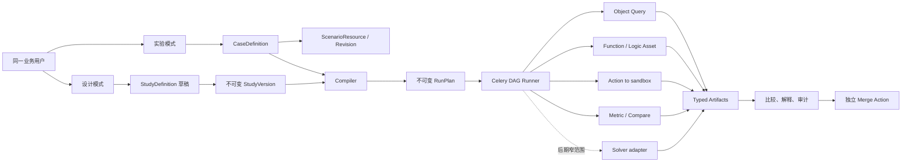

# 制造业情景推理全链条设计计划

> 状态：设计计划，不包含功能实现  
> 审计基线：`origin/merge-delivery@ce087df99d88e45fed2e83bbc3cfdddfc1a400ba`  
> 调研日期：2026-10-11  
> 范围：制造业供应链、生产、设备、质量、能源和排程情景

## 决策摘要

保留现有 `ScenarioResource` 作为隔离数据修改的权威沙箱，保留 PostgreSQL、FalkorDB、Redis/Celery、`ExecutionContext`、Action、Logic Asset 和 merge 流程。新增一个通用、可版本化的 Study 定义层，使同一个业务用户可以先定义参数、输入、步骤、指标和约束，再创建、运行、比较 cases。每次运行先编译成不可变 `RunPlan`，固定 Study 版本、Scenario revision、数据视图和函数/Action 版本。

当前最大的缺口不是“再加一个参数表单”，而是 Study 仍被写死为供应商演示：数据库只有单一 `model_key/version` 和松散的 `parameter_projection`，worker 固定调用 `SUPPLIER_RESILIENCE_ASSET`，前端固定供应商字段；另一套 `WhatIfScenario/WhatIfRun` 又形成了竞争语义。第一阶段应先建立 Study/Case/RunPlan 的契约和迁移，再做通用设计界面。

首期不增加数据库、独立 worker 平台或工作流引擎。Celery 继续执行有界 DAG。OR-Tools 与 HiGHS只做有已知答案数据集支撑的窄范围 spike；未达到正确性和性能门槛前不进入正式运行路径。LLM只辅助提出候选假设、映射字段和解释结果，不负责宣称最优，也不能直接写入实时数据。

## 1. 目标和非目标

### 1.1 目标

1. 建立从“定义研究”到“创建 case、运行、比较、审核、合并”的制造业情景推理全链条。
2. 同一用户在两个模式间切换：
   - **设计模式**：定义并发布版本化 Study 模板。
   - **实验模式**：从已发布版本创建 cases，运行、比较并解释结果。
3. 同时覆盖两种互补能力：
   - **Scenario 沙箱**：在隔离世界状态中应用 Action、查看对象和关系变化、再受控合并。
   - **推理工作台**：把输入、函数、规则、时间序列、指标和后续步骤组成可复现的计算图。
4. 支持制造业中的供应中断、需求波动、库存策略、产线能力、设备维护、质量、能源与排程问题。
5. 每个结果都能回答：用了哪份数据、哪个本体修订、哪个 Study/函数/Action 版本、哪些参数、谁运行、何时运行、是否完整。
6. 保持 `origin/merge-delivery@ce087df` 已有 Scenario、Action 和 merge 能力可用，并提供明确的兼容迁移路径。

### 1.2 非目标

- 首期不提供任意用户代码执行环境。
- 首期不构建通用 notebook、模型训练平台或新的本体存储引擎。
- 首期不把所有制造业算法都内置到平台；平台提供有类型、有版本的适配边界。
- 首期不让 scenario run 自动写入实时本体；合并仍是单独、可授权、可审计的 Action。
- 首期不以 LLM 输出作为约束可行性、数学最优性或写操作授权的依据。
- 本计划的案例、数据和验收只覆盖制造业。

## 2. 由本地文章提炼的制造业问题

下表把文章中的多步推演、数字孪生、Action 闭环、指标一致性等思想转成可验收的产品问题。它们是需求来源，不代表文章中的架构描述已经由官方资料证实。

| 场景族 | 用户提出的 what-if 问题 | 输入变化 | 需要传播的影响 | 关键结果 |
| --- | --- | --- | --- | --- |
| 多级供应中断 | 二级供应商停供两周，哪些订单会延期？ | 可用量、恢复日期 | 供应商→物料→BOM→工单→订单 | 缺料量、延期订单、恢复时间 |
| 替代供应 | 改用供应商 B 或替代材料后是否可行？ | 供应商、价格、提前期、替代率 | 采购、库存、质量、交付 | 服务水平、成本、风险告警 |
| 安全库存 | 安全库存提高 20% 会减少多少缺货？ | 补货点、安全库存 | 库存、采购、仓储 | 缺货率、持有成本、积压 |
| 需求波动 | 某产品需求增加 30% 时瓶颈在哪里？ | 需求曲线、优先级 | 产能、物料、排程、交付 | 吞吐、在制品、延期、瓶颈资源 |
| 物流延迟 | 入厂运输延迟三天会影响哪些批次？ | 运输时间、到货窗口 | 收货→工单→成品→客户 | 延期批次、加急成本 |
| 设备退化 | 设备效率逐日下降时何时应维护？ | 效率曲线、故障概率 | 产能、排程、质量 | 停机风险、产量、维护窗口 |
| 维护选择 | 现在停机维护还是延后更好？ | 维护时段、持续时间 | 资源冲突、订单承诺 | 产量损失、风险、交付变化 |
| 产线调整 | 降速、换线、加班或外协分别怎样？ | 班次、速度、路由、外协能力 | 排程、成本、人员和设备负载 | 完工率、成本、资源利用率 |
| 良率与返工 | 良率下降 5% 后原料和交付如何变化？ | 良率、报废率、返工时长 | 原料需求、工序队列、库存 | 报废、返工量、单位成本、延期 |
| 能源约束 | 电价峰值或功率上限变化时如何排产？ | 分时电价、能耗、功率上限 | 工序时间与资源分配 | 能源成本、峰值功率、交付 |
| 连锁效应 | 第一次调整后会出现哪些二、三级影响？ | 一组有序 Action | 跨对象、跨时间依赖 | 影响链、因果证据、恢复曲线 |
| 方案闭环 | 选定 case 后如何安全进入执行流程？ | 被选 case、适用范围 | 预览→校验→Action→合并 | 冲突、授权、审计记录 |

## 3. 当前仓库现实和差距

### 3.1 已有能力，应保留

- `backend/app/models/v2/scenario.py`
  - `ScenarioResource` 已表达 ontology、owner、base view、head revision、ETag、TTL、pinned/tracking、rebase 和保护标记。
  - `ScenarioRevision` 是不可变修订，含结果视图、logic manifest digest 和 content digest。
  - `ScenarioChangeSet` 保存有序 edits、payload hash 和幂等请求 ID。
  - `ScenarioRun` 已有状态、进度、输入/输出 digest、结果 manifest、Celery task、study/case 引用、依赖 run 和取消字段。
  - 已有 stages、metrics、warnings、artifacts、grants 和 audits，可扩展而无需另建运行记录体系。
- `backend/app/routers/v2/scenarios.py` 已覆盖 Scenario CRUD、复制、changeset 校验、发布修订、授权、运行和取消。
- `backend/app/routers/v2/scenario_workbench.py` 已覆盖 live 创建、rebase、Action Type 管理、Action 预览/提交、workspace、比较、merge preview 和 merge。
- `ExecutionContext` 和 Object Query 的 data view 机制可以让查询、函数和 Action 读取同一个 scenario snapshot。
- PostgreSQL 适合权威定义、修订和运行元数据；FalkorDB 继续承担图投影；Redis/Celery 已承担异步执行。
- 前端已使用 React、TypeScript、TanStack Query/Table、ECharts、react-querybuilder、Cytoscape、XYFlow 和 Playwright，足以构建设计器和实验工作台。

### 3.2 “自定义 scenario”没有完成好的具体证据

1. `ScenarioStudy` 只有单一 `model_key/model_version/config_alias`，无法表达多步骤执行图、每个节点的类型、版本、输入输出和依赖。
2. `parameter_projection` 是松散 JSON；没有参数类型、单位、范围、枚举、默认值、敏感级别和跨参数约束的权威定义。
3. `ScenarioStudyCase` 保存参数和一个 `action_key`，无法表达有序的多 Action、节点级 override、case 继承和参数来源。
4. `backend/app/tasks/v2/scenario.py` 固定导入和执行 `SUPPLIER_RESILIENCE_ASSET`，并查询供应商专用对象与指标；Study 记录并不能真正选择运行图。
5. `frontend/src/pages/what-if/SupplierStudyPage.tsx` 固定供应商、产能、成本字段及文案。用户可改预置参数，却不能定义 Study 的输入、输出、指标、约束、函数版本和步骤。
6. `frontend/src/pages/what-if/WhatIfWorkbenchPage.tsx` 固定演示资产、日期、范围和模型来源。
7. `backend/app/models/v2/dynamic_ontology.py` 另有 `WhatIfScenario/WhatIfRun`；`routers/v2/what_if.py` 接受宽泛 dict 并运行独立引擎。它与 `ScenarioResource/ScenarioRun` 对 scenario、revision、状态和结果各有一套语义。
8. 当前比较能力偏供应商模板，没有通用 metric schema、目标方向、约束状态、单位兼容、排序和 Pareto/敏感性接口。
9. 当前没有“发布后的不可变 StudyVersion”和“运行前编译的不可变 RunPlan”，因此不能证明旧 run 可按原定义解释或复现。
10. 没有通用 batch experiment、参数扫描、敏感性分析、候选推荐与选择依据。

### 3.3 基线验证结果

在该代码状态上执行以下聚焦测试：

```text
pytest -q tests/test_scenario_actions.py tests/test_scenario_merge_preview.py \
  tests/test_scenario_tracking.py tests/test_supplier_study_model.py \
  tests/v2/test_dynamic_ontology_what_if.py
```

结果为 `18 passed, 6 errors, 12 warnings`。6 个 error 都发生在 `test_supplier_study_model.py` 的 setup：`manufacturing_data.py` 期望 frePPLe JSON 原始字节 SHA-256 为 `d7eb...`，当前文件为 `59637D...`。这属于**既有但直接阻塞的 fixture 完整性问题**，可能来自换行字节差异或 fixture 漂移；Phase 0 必须调查并修复，不能删掉校验或改成永远通过。

前端 `node_modules` 不存在，本轮没有把未安装依赖造成的 lint/build 缺席记为产品回归。实施时必须安装锁定依赖后执行独立门禁。

## 4. 证据账本

### 4.1 本轮实际阅读的本地设计和代码

| 材料 | 阅读重点 | 支持的结论 |
| --- | --- | --- |
| `docs/PLAN_PERSON_A_SEMANTIC_CORE_SECURITY_DATA_PLANE.md` | 语义核心、安全、数据面及来源账本 | Study 必须复用统一身份、权限和数据视图，不另造数据面 |
| `docs/PLAN_PERSON_B_OPERATIONAL_RUNTIME_UX.md` | 运行时、UX、异步任务、错误态 | 运行计划、状态、取消、恢复和用户流程需共同设计 |
| `docs/PLAN_A_PLAN_B_INTEGRATION_CONTRACT.md` | A/B 边界、digest、revision、ExecutionContext | 本计划沿用集成契约，不重复定义对象查询和权限体系 |
| `docs/PLAN_SCENARIO_CONTEXT_PROVIDER.md` | Scenario 上下文到 data view 的解析 | 所有节点应通过同一 ExecutionContext 读取隔离状态 |
| `docs/PALANTIR_ONTOLOGY_GAP_AUDIT_2026_09_23.md` | 已知产品差距和既有来源入口 | 用于交叉检查，不把二手归纳当作新官方证据 |
| `backend/app/models/v2/scenario.py` | Scenario/Revision/Run/Study/Case 数据模型 | 已有沙箱和 run 基础可扩展；Study 定义不足 |
| `backend/app/models/v2/dynamic_ontology.py` | 第二套 what-if 表 | 存在竞争 scenario/run 目录，需要迁移收敛 |
| `backend/app/routers/v2/scenarios.py` | 通用 Scenario API | 沙箱 CRUD、版本、运行和权限应保留 |
| `backend/app/routers/v2/scenario_workbench.py` | Action、compare、merge | 合并是显式受控步骤，不属于模型执行节点的隐式副作用 |
| `backend/app/routers/v2/supplier_studies.py` | 供应商 Study/Case API | 可作为兼容 facade，但领域字段不能继续定义通用契约 |
| `backend/app/routers/v2/what_if.py` | 独立 what-if API | 宽泛 dict 和独立后台任务不满足统一版本/执行语义 |
| `backend/app/tasks/v2/scenario.py` | Celery 执行流程 | worker 硬编码供应商 asset，是自定义 Study 的主要断点 |
| `backend/app/services/v2/logic_assets.py` | Logic Asset 静态注册 | 可先作为版本化 function node 的适配器 |
| `frontend/src/pages/what-if/SupplierStudyPage.tsx` | Study 用户流程 | 已有 case/compare 外壳，但内容和参数写死 |
| `frontend/src/pages/what-if/WhatIfWorkbenchPage.tsx` | 旧 workbench 流程 | 需要迁到统一 Study/Case API |
| `frontend/src/pages/what-if/GenericScenarioWorkbenchPage.tsx` | 通用 Scenario 入口 | 可保留为沙箱入口并链接到 Study |
| 相关 scenario、supplier study、dynamic what-if 测试 | 现有可观察契约与失败 | 形成 Phase 0 回归基线和迁移兼容要求 |

### 4.2 本轮阅读的本地分析文章

这些文章用于发现制造业应用问题和项目语境，架构结论仍以官方材料和仓库代码验证。

- `articles/多步模拟与跨时间因果推演_系统设计.md`：多步状态演化、跨时间影响链、恢复曲线。
- `articles/Palantir本体工程参考(二)-可编程数字孪生.md`：可编程状态、模型和 Action 闭环。
- `articles/Palantir本体工程参考(一)-架构总览与智能体.md`：数据、语义、逻辑、Action 分层。
- `articles/本体方案.md`：项目内本体与应用构想。
- `articles/Palantir本体论建模平台深度解析.md`：建模与运行工作流线索。
- `articles/Palantir平台深度解析-数据OS到AI-OS.md`：平台分层和运营闭环线索。
- `articles/人员2模块验证报告.md`：已有模块和验证记录的交叉检查。
- `articles/本体第一人称视角与Ontology_Action辨析.md`：Action 与对象状态修改的边界。

### 4.3 Plan A/B 已覆盖、因此本轮去重跳过的材料

本轮没有重新全文阅读 A/B 已经逐条消化的 Object Types、Link Types、Interfaces、Object Sets/Search、Actions、Functions、Object Explorer/Views、基础权限和索引页面。去重依据是下列三份本地计划中的来源账本和集成契约：

- `docs/PLAN_PERSON_A_SEMANTIC_CORE_SECURITY_DATA_PLANE.md`
- `docs/PLAN_PERSON_B_OPERATIONAL_RUNTIME_UX.md`
- `docs/PLAN_A_PLAN_B_INTEGRATION_CONTRACT.md`

若实现阶段修改这些共享契约，必须重新打开相应官方页面并记录访问日期；不能只引用旧计划摘要。

### 4.4 本轮新读的 Palantir 官方公开文档

| 官方文档 | 阅读的实质内容 | 本计划采用的公开契约 |
| --- | --- | --- |
| [Ontology Scenarios overview](https://www.palantir.com/docs/foundry/ontology/overview-ontology-scenario/) | sandbox、Action、比较、TTL、tracking/rebase、限制 | Scenario 是隔离变更层，不是历史版本系统；merge 另有条件 |
| [Temporary scenarios](https://www.palantir.com/docs/foundry/ontology/temporary-scenario/) | 会话生命周期和 scenario-aware widgets | 临时 scenario 可作为未保存草稿体验，不能成为可复现 run 的唯一依据 |
| [Persisted scenario metadata](https://www.palantir.com/docs/foundry/ontology/persisted-scenario/) | 持久元数据、分享、审计、过期 | 持久 Scenario 需要稳定身份、owner、生命周期和审计 |
| [Merge a scenario](https://www.palantir.com/docs/foundry/ontology/merge-scenario/) | Apply Scenario Action、范围、criteria、事务 | merge 必须显式授权并在一个事务中重验，而非复制数据库行 |
| [OSDK scenarios](https://www.palantir.com/docs/foundry/ontology/osdk-scenario/) | scoped client、限制、edited entities、merge | query/action 都携带相同 scenario scope；不支持嵌套 scenario |
| [Vertex scenarios overview](https://www.palantir.com/docs/foundry/vertex/scenarios-overview/) | Actions、models、inputs/outputs、chaining、time series | Study 需要输入、输出和可组合步骤，Scenario 承载状态变化 |
| [Vertex scenarios getting started](https://www.palantir.com/docs/foundry/vertex/scenarios-getting-started) | 参数 projection、override、baseline、cases | baseline/case/parameter projection 是核心用户概念 |
| [Vertex scenario options](https://www.palantir.com/docs/foundry/vertex/scenarios-options) | 时间窗、smoothing、graph scope、显示和 override | 时间、范围和可覆盖参数属于 Study/Case 契约 |
| [Chained models](https://www.palantir.com/docs/foundry/vertex/chained-models) | 输出到输入传播及 sunset 指引 | 项目可保留 DAG 语义，但节点引用应优先走函数/Action，不复制将退出的直接模型 UX |
| [Models](https://www.palantir.com/docs/foundry/model-integration/models) | 模型类型、artifact/adapter、版本、权限、lineage | 模型实现通过版本化适配器注册，不把文件路径暴露为公共 API |
| [Modeling Objectives](https://www.palantir.com/docs/foundry/model-integration/objectives) | problem interface、实现、submission/release/deployment | “问题定义”与“算法实现”分离，版本和评测可追溯 |
| [Functions on models](https://www.palantir.com/docs/foundry/functions/functions-on-models) | 类型化输入输出、依赖、运行限制 | function node 必须精确类型化并受预算约束 |
| [Function-backed Actions](https://www.palantir.com/docs/foundry/action-types/function-actions-overview) | 复杂多对象/关系 edits 和限制 | 复杂改变通过 Action 产生、校验和授权 |
| [Function-backed time series](https://www.palantir.com/docs/foundry/time-series/function-backed-time-series-overview) | 参数化生成、cache/stream、并排比较 | 预测曲线作为类型化 artifact/series，不塞入任意 JSON 指标 |
| [Dynamic Scheduling core concepts](https://www.palantir.com/docs/foundry/dynamic-scheduling/scheduling-concepts/) | schedule/resource、scenario、save/search/suggestion/validation functions | 排程建议与校验读取 active scenario 当前状态；拖放修改通过 Action 暂存 |
| [The Ontology system](https://www.palantir.com/docs/foundry/architecture-center/ontology-system/) | Ontology 表达企业决策和互联运营资产 | 数据、逻辑、Action 和应用应围绕同一语义层协作 |

公开页面会变化。这里记录的是 2026-10-11 可见内容，不声称了解其私有后端实现。

### 4.5 本轮实际阅读的官方公开 SDK 源码和测试

官方仓库：[`palantir/osdk-ts`](https://github.com/palantir/osdk-ts)，审阅 commit `9bda6a19a2549851c3b5d0444f3cb16194f04580`。

| 文件 | 源码/测试揭示的行为 | 对本项目的影响 |
| --- | --- | --- |
| `packages/client/src/scenarios/ScenarioClient.ts` | Scenario client 是普通 client 的装饰层；向对象、查询和 Action 请求注入 scenario RID | 统一 `ExecutionContext`，避免每个 router 自行解释 scenario |
| `ScenarioClient.test.ts` | 嵌套 scenario 报错；已有 transaction 时 scenario 被忽略并警告；edited object 可重复且需去重 | 编译器拒绝嵌套；事务与 scenario 组合必须有明确错误；列表做稳定去重 |
| `createScenario.ts` / `.test.ts` | 创建后返回 scoped client | Case 运行不应要求业务节点手工重复传 scenario ID |
| `withScenario.ts` / `.test.ts` | 现有 client 被绑定到一个 scenario | runner 负责一次绑定并传递上下文 |
| `actions/applyAction.ts` | Action 请求接受 scenario scope | sandbox Action 和 live merge 共用 Action 语义但权限/目标不同 |
| `queries/applyQuery.ts` | query 请求接受 scenario scope | 所有 read/aggregate/function lookup 使用同一快照 |

源码还表明 edited objects 返回的是稀疏标识，完整属性需重新查询；一对多 link edit 可能表现为持有外键一侧的 object edit，多对多 link edit 单独返回；冲突是时间点判断，可能过期且受权限过滤。因此 merge preview 只是提示，最终 merge 必须重新校验。

另查阅官方 [`foundry-platform-python`](https://github.com/palantir/foundry-platform-python) 生成文档中的 `docs/v2/Ontologies/Query.md` 和 `Action.md`：query/action 请求有 `scenario_rid` 等上下文字段，Action 的 HTTP 成功仍需检查 validation 结果。平台 SDK 暴露的 batch action 字段与高层 OSDK scenario 页面所述限制存在表面差异；本项目采用较窄契约，首期不提供 scenario 内 batch Action，待官方契约和实际测试一致后再评估。

### 4.6 证据类型标记

后文每项关键设计按以下标记理解：

- **[公开契约]**：上述官方文档明确说明。
- **[公开源码]**：官方公开 SDK 源码或测试可观察行为。
- **[项目事实]**：当前仓库代码、迁移、测试或依赖显示。
- **[项目设计]**：为满足本项目目标作出的选择，不宣称是参考产品内部实现。
- **[待验证]**：需要 spike、真实集成或官方契约进一步确认。

## 5. 参考语义和必须保持的不变量

1. **Scenario、Study、Case、Run 是四个概念。** Scenario 是隔离数据状态；Study 是问题与执行图定义；Case 是某个 StudyVersion 下的一组 override 和 Action；Run 是一次固定输入的终态执行记录。[公开契约][项目设计]
2. **一个概念只有一个权威表示。** `ScenarioResource` 是 scenario 权威目录；新 `StudyDefinition/StudyVersion` 是 Study 权威目录；旧 API 只能做代理。[项目设计]
3. **草稿可变，发布版本不可变。** 发布后只能创建新 `StudyVersion`；历史 Case/Run 永远引用原版本。[项目设计]
4. **运行前编译。** 结构校验、实时本体校验、权限、版本解析和预算形成不可变 `RunPlan`；worker 不再临时猜测语义。[项目设计]
5. **操作顺序有语义。** Case 中 Action 列表保持用户顺序；DAG 只允许无环图，并用稳定拓扑排序生成执行次序。[公开契约的延伸][项目设计]
6. **同一执行上下文。** Object Query、Function、Action preview/apply、aggregate 和 solver adapter 都接收同一个 `ExecutionContext`，包含 ontology、data view、scenario/revision、principal 和时间。[公开源码][项目事实]
7. **可复现 run 必须固定。** 即使编辑体验使用 tracking scenario，run 仍固定解析后的 scenario revision/data view、StudyVersion、节点实现版本和 metadata digest。[项目设计]
8. **tracking 和 pinned 明示。** tracking 的自动 rebase、冲突和旧 run 不受影响必须在 UI/API 中可见；不静默改变已排队 run。[公开契约][项目设计]
9. **结果不等于写入。** function/solver/aggregate 节点只产出 typed artifacts；Action 节点只能把 edits 应用到 sandbox；实时合并必须走单独 merge Action。[公开契约]
10. **权限逐阶段、逐入口一致。** 创建 Study 的用户也必须对运行时读取字段、调用函数、应用 Action 和 merge 分别有权限。同一用户承担两种使用模式不代表取消授权检查。[公开契约][项目设计]
11. **字段级投影先于执行。** 隐藏字段不能进入参数候选、日志、trace、LLM prompt 或 artifact；权限变化使旧 compile cache 失效。[项目设计]
12. **错误不能伪装为空结果。** 至少区分 invalid definition、metadata stale、permission denied、dependency unavailable、partial result、timeout、cancelled、infeasible 和 internal error。[项目设计]
13. **求解状态精确。** `time_limit`、`feasible`、`optimal`、`infeasible`、`unknown` 独立；有界 gap/bound 随结果记录，超时不能显示为最优。[项目设计]
14. **幂等和去重。** mutation 接收 `client_request_id`；run input digest 相同可按策略复用结果，但必须返回复用来源；edited entity 列表稳定去重。[公开源码][项目事实]
15. **冲突预览不是最终保证。** merge preview 可过期；最终操作在锁/事务内重新验证 base、权限、criteria 和冲突。[公开源码][公开契约]
16. **Provenance 一等化。** 每个 metric/artifact 都记录 node、输入 digest、实现版本、数据修订、单位、完整性和生成时间。
17. **资源有界。** StudyVersion 定义节点数、fan-out、对象数、时间窗、artifact 大小、wall time 和重试预算；超限返回稳定错误。

## 6. Design corrections

| Previous assumption | Evidence | Corrected design | Impact on existing code | Action |
| --- | --- | --- | --- | --- |
| Scenario 本身可同时代表研究定义、case 和 run | 官方 Scenario 是隔离 edits；仓库已有四类记录但边界混杂 | 四层身份分开并互相引用 | `ScenarioStudyCase`、router response、URL 状态需明确 ID | refactor |
| 给现有供应商表单增加字段即可完成自定义 | worker、Logic Asset 和前端都硬编码供应商 | 先建版本化 Study spec、compiler 和通用 node adapter | 替换 supplier-specific execution path；演示转模板 | replace |
| 直接 model chaining 是长期核心抽象 | Vertex chained models 页面标记 sunset，并指向 function-backed Action | DAG 保留，但节点引用版本化 Function/Action/adapter | `model_key` 迁到 node implementation ref | migrate |
| `WhatIfScenario` 可长期作为独立目录 | 项目同时有 `v2_what_if_scenarios` 与 `ScenarioResource` | `WhatIf` API 转 compatibility facade，数据迁到 canonical catalog | migration service 和旧 UI 需双读校验后切换 | deprecate |
| 比较页里的 metrics JSON 足够 | 多模型、多单位、多目标比较需要类型、方向和来源 | 新增 MetricDefinition 与 typed MetricArtifact | 旧 `ScenarioMetricSnapshot` 加 schema/version/provenance | extend |
| merge preview 无冲突即可直接提交 | 官方 SDK 表明冲突判断会过期且受权限过滤 | merge 事务中重新校验，preview 带有效期和 base digest | `scenario_workbench` merge 服务增加最终验证 | extend |
| 合并等于把 scenario 行复制到 live | 官方 merge 是 Apply Scenario Action 和受控事务 | merge 仍通过 Action 产生 edits，限定对象/关系范围 | 保留 Action 审计，不新增直接 DB copy | preserve |
| 同一用户设计并运行就无需角色边界 | 权限仍适用于数据、Function、Action、merge | UI 不强分组织角色，后端仍逐资源授权 | Study publish/run/merge 增加一致检查 | extend |
| tracking scenario 可直接代表可复现输入 | 自动 rebase 会改变 head；历史 run 需稳定解释 | compile 时解析并固定 revision/data view | RunPlan 新增 resolved context digest | extend |
| 原始文件字节 hash 在所有环境稳定 | frePPLe fixture 在当前 checkout 发生 hash mismatch | 先判断期望是原始发行物还是规范化内容；保存来源、raw hash 和 canonical content hash | `manufacturing_data.py` 和 fixture manifest | refactor |
| solver 返回一个“最佳方案”即可 | OR/MIP 求解存在 feasible、gap、timeout 等状态 | 标准 SolverResult，状态、bound、gap、seed、limits 全记录 | 新 adapter contract 和 UI 状态 | extend |
| 高层和底层 SDK 的 batch 行为可合并推断 | 两类官方公开接口呈现不同范围 | 首期采用较窄的无 scenario batch 契约 | compiler 拒绝该组合并给稳定错误 | preserve |
| LLM 能直接决定方案和写入 | LLM 无法提供确定性可行性和授权证明 | LLM 只生成候选、字段映射和解释；compiler、solver、Action 决定有效性 | 新 provenance 和人工确认边界 | extend |

## 7. 目标架构



### 7.1 权威领域模型

#### `StudyDefinition`

可变资源，字段包括：`id`、`ontology_id`、`name`、`description`、`status=draft|published|archived`、`owner_id`、`latest_version`、`etag`、时间戳。它提供稳定 URL 和授权边界，不保存某次发布的可变副本。

#### `StudyVersion`

不可变发布物：

```json
{
  "study_id": "study-...",
  "version": 3,
  "spec_version": "scenario-study/v1",
  "ontology_metadata_digest": "sha256:...",
  "context_policy": {"scenario_mode": "pinned_on_run", "time_required": true},
  "parameters": [{"key": "demand_multiplier", "type": "decimal", "unit": "ratio", "min": 0.5, "max": 2.0, "default": 1.0}],
  "nodes": [{"key": "demand", "kind": "function", "implementation": {"key": "demand_projection", "version": "1.2.0"}, "inputs": {}}],
  "edges": [{"from": "demand.output", "to": "capacity.demand"}],
  "metrics": [{"key": "late_orders", "type": "integer", "direction": "minimize", "unit": "count"}],
  "constraints": [{"key": "service_floor", "expression_ref": "service_level_gte", "severity": "hard"}],
  "budgets": {"max_nodes": 50, "max_objects": 100000, "max_wall_seconds": 900, "max_artifact_bytes": 52428800}
}
```

规范化 JSON 计算 `spec_hash`；排序只用于无语义 map，`nodes`、`edges` 和 ordered actions 不随意重排。发布必须记录 metadata digest、创建者、变更说明和兼容级别。

#### `CaseDefinition`

引用精确 `study_version_id` 和一个 `ScenarioResource`。保存：typed parameter overrides、按顺序的 sandbox Actions、可选 `source_case_id`、case hash、ETag、状态。baseline 是同一模型中的明确 `case_kind=baseline`，不是特殊的隐藏代码路径。

#### `RunPlan`

编译后的不可变终态计划，至少固定：

- `study_version_id/spec_hash`
- `case_id/case_hash`
- `scenario_id/resolved_revision/data_view_id`
- `ontology_metadata_digest` 与 `permission_projection_digest`
- 已解析且通过类型检查的 inputs/outputs
- 稳定拓扑顺序与有序 Actions
- 每个 Function、Action、Logic Asset、model/solver adapter 的精确版本
- executor 版本、随机 seed、时区、时间窗和资源预算
- 输入对象集合 snapshot/digest 策略

只有 compile 成功的 `RunPlan` 才能入队。worker 不读取“latest”定义。

#### 节点类型 v1

| kind | 作用 | 副作用 | 首期状态 |
| --- | --- | --- | --- |
| `object_query` | 取得有权限的 snapshot/object set | 无 | 支持 |
| `function` | 确定性业务规则、预测、传播 | 无 | 支持，适配 Logic Asset |
| `action_preview` | 校验并生成 edits | 无 | 支持 |
| `action_apply_scenario` | 按顺序把 edits 写入 sandbox | 仅 Scenario | 支持 |
| `aggregate_metric` | 生成类型化指标 | 无 | 支持 |
| `compare` | baseline/case 差异和目标方向 | 无 | 支持 |
| `time_series` | 生成类型化序列 artifact | 无 | 支持 |
| `solver` | 离散/线性优化 | 无，只返回候选 | spike 通过后启用 |

首期拒绝 `arbitrary_code`、任意容器和未注册模型节点。

### 7.2 编译与执行边界

编译分两层，错误分别返回：

1. **结构校验**：JSON Schema、唯一 key、引用存在、DAG 无环、端口类型、单位、参数范围、预算上限。
2. **领域校验**：对象/属性/关系是否仍存在、Function/Action 版本可用、用户权限、data view 可读、tracking head 可解析、字段可见性、Action 是否允许在 scenario 中执行。

runner 根据 `RunPlan` 执行有界 DAG。每个 stage 采用状态机 `pending → running → succeeded|failed|cancelled|skipped`，结果先写临时 artifact，再用 digest 原子登记。重试只能重放声明为幂等且输入 digest 相同的节点。取消必须传播到未开始节点，并由长任务周期检查 cancellation token。

### 7.3 API 草案

公共请求只使用领域字段，不暴露 SQL、Cypher、队列名或 worker 路径。

```text
POST   /api/v2/ontologies/{ontology_id}/scenario-studies
GET    /api/v2/ontologies/{ontology_id}/scenario-studies/{study_id}
PATCH  /api/v2/ontologies/{ontology_id}/scenario-studies/{study_id}
PUT    /api/v2/ontologies/{ontology_id}/scenario-studies/{study_id}/draft-spec
POST   /api/v2/ontologies/{ontology_id}/scenario-studies/{study_id}:validate
POST   /api/v2/ontologies/{ontology_id}/scenario-studies/{study_id}:publish
GET    /api/v2/ontologies/{ontology_id}/scenario-studies/{study_id}/versions/{version}

POST   /api/v2/ontologies/{ontology_id}/scenario-studies/{study_id}/cases
PATCH  /api/v2/ontologies/{ontology_id}/scenario-studies/{study_id}/cases/{case_id}
POST   /api/v2/ontologies/{ontology_id}/scenario-studies/{study_id}/cases/{case_id}:compile
POST   /api/v2/ontologies/{ontology_id}/scenario-studies/{study_id}/cases/{case_id}/runs

GET    /api/v2/ontologies/{ontology_id}/scenario-runs/{run_id}
POST   /api/v2/ontologies/{ontology_id}/scenario-runs/{run_id}:cancel
POST   /api/v2/ontologies/{ontology_id}/scenario-runs/{run_id}:retry
POST   /api/v2/ontologies/{ontology_id}/scenario-studies/{study_id}:compare
```

mutation 使用 ETag/`If-Match` 和 `client_request_id`。错误体统一含 `code`、`message`、`path/node_key`、`retryable`、`details`、`trace_id`，但不返回隐藏字段值。

### 7.4 UI 信息架构

同一页面提供清晰的“设计 / 实验”切换，不要求不同岗位：

- **设计模式**：基本信息 → context policy → 参数 → 执行图 → metrics/constraints → budgets → validate → publish。
- **实验模式**：选择发布版本 → baseline/cases → 修改参数和 ordered Actions → compile → run → compare → 查看影响链和 provenance → 打开 merge preview。

表单由 canonical Study schema 渲染；DAG 编辑先采用受控节点和端口，不允许粘贴任意代码。每次保存显示 validation errors。发布后页面只读，用户通过“创建新版本”继续编辑。比较页显示单位、方向、constraint 状态、完整性和与 baseline 的绝对/相对差异；solver 状态与最优 gap 单独显示。

## 8. 兼容和迁移设计

1. 新表与旧表并行上线，不修改既有 ID。
2. 将现有 supplier `ScenarioStudy` 转成一个系统提供的 `manufacturing_supplier_resilience/v1` StudyVersion；每个 `ScenarioStudyCase` 映射到 CaseDefinition，继续引用原 `ScenarioResource`。
3. 旧 `/scenario-studies/...` supplier 请求先由 facade 翻译到新服务，响应保持旧字段；记录调用量和不兼容告警。
4. 把 `WhatIfScenario.assumptions_json/rule_overrides_json` 规范化为 case parameters + ordered action overrides；`WhatIfRun` 迁移/关联到 canonical run。
5. 旧 `/what-if/...` API 进入只读兼容期，新的写请求由 facade 创建 canonical 资源；双写只允许通过一个服务事务，禁止 router 各写一份。
6. 对旧 run 生成 provenance backfill manifest；无法证明的字段明确为 `unknown_legacy`，不伪造版本。
7. 对数、状态、digest 和 compare 结果双读校验达到门槛后，前端切换统一 API。
8. 只有连续两个发布周期无旧写入、迁移计数对齐、回滚演练通过，才删除旧写路径；表删除另开迁移审批。

## 9. 开源组件决策矩阵

| 组件 | 决策 | 满足的窄角色 | 项目仍拥有的语义 | 改变决定的条件 |
| --- | --- | --- | --- | --- |
| PostgreSQL / SQLAlchemy / Alembic | 采用现有 | 权威定义、版本、run、审计、事务 | Study/Case/RunPlan 契约、权限、provenance | 无需新增数据库 |
| FalkorDB | 采用现有 | 本体关系投影和影响遍历 | snapshot 一致性、权限、fallback 错误 | 实测图查询无法达到 SLO 时再审视索引/投影 |
| Redis / Celery 5.4 | 采用现有 | 有界异步 DAG、重试、取消信号 | 编译、幂等、stage 状态、恢复和审计 | 真实负载反复出现恢复/编排缺陷且本地修复不足时评估工作流引擎 |
| [Google OR-Tools](https://github.com/google/or-tools) | spike first | CP-SAT、排程、路由、离散约束 | 单位、业务约束、输入映射、权限、结果状态和 provenance | 已知答案 fixture、UCI/制造 fixture 和性能门槛全部通过后窄范围采用；Apache-2.0 |
| [HiGHS](https://github.com/ERGO-Code/HiGHS) | spike first | LP/MIP/QP 的库存和分配问题 | 同上，且不与 OR-Tools 争夺同一模型所有权 | 线性问题在正确性、gap、部署体积上优于备选后采用；MIT |
| [SimPy](https://simpy.readthedocs.io/en/latest/) | reference only | 产线队列/离散事件原型 | 平台运行、版本、权限、取消、provenance | 出现经验证的队列模拟需求且自有函数不够时做独立 spike；MIT |
| [JSON Forms](https://jsonforms.io/api/react/) | adopt for narrow role | 根据 JSON Schema 渲染参数/约束表单 | canonical schema、领域校验、权限和保存 | React/TS 兼容性与可访问性 spike 失败则使用现有受控组件；MIT |
| TanStack Table/Query、ECharts、Cytoscape、XYFlow | 采用现有 | 表格、缓存、图表、影响图和 DAG UI | 领域含义、状态恢复、API 契约 | 仅在真实 UX 缺口出现时更换 |
| Temporal 或新工作流服务 | defer | 长流程持久编排 | 当前全部领域契约 | 同范围测试连续出现跨 worker 恢复/补偿失败，并证明 Celery 修复成本更高 |
| 新独立数据库 | reject for current scope | 无必要角色 | 现有存储足够 | 只有实测容量、一致性或查询要求无法由现有存储满足时重评 |

求解器按模型类型选择，不把两个库同时塞进每个 worker image。adapter 必须可替换，Study spec 引用能力和版本，不依赖库的原生对象序列化。

## 10. 分阶段实施计划

### Phase 0：证据和基线冻结

**工作**

- 建立 `ce087df` 可复现 checkout，记录 Python/Node/PostgreSQL/FalkorDB/Redis 版本和迁移 head。
- 调查 frePPLe fixture hash：比较发行来源、Git 属性、CRLF/LF 和解析后规范化内容；决定 raw hash 与 canonical hash 的各自用途，更新 manifest 和回归测试。
- 运行完整 scenario 聚焦测试、迁移 up/down/up、前端 lint/build/E2E 基线，按失败分类记录。
- 把本文来源 URL、官方 SDK commit、数据集版本写入机器可读 evidence manifest。

**门禁**

- 聚焦后端测试无 setup error；任何真实断言失败均被分类并有 owner。
- fixture 同时验证来源、raw bytes（若要求逐字节）和 canonical content，Windows/Linux 结论一致。
- Alembic 单一 head，空库和现有快照都能迁移。
- 前端依赖按 lockfile 安装，lint 配置能解析 TSX/test/JS/MJS。

### Phase 1：Study 语义核心与 compiler

**工作**

- 添加 `StudyDefinition`、`StudyVersion`、`CaseDefinition`、`RunPlan`、typed definition/artifact schema 和迁移。
- 实现 canonical JSON、hash、ETag、不可变 publish、版本兼容标记。
- 实现结构/领域两阶段 validator、DAG cycle/type/unit 检查、稳定拓扑排序、预算和稳定错误码。
- 建立 Function/Action/Logic Asset registry adapter；禁止 arbitrary code。
- 实现 create/edit/validate/publish/get-version/compile API，不接 UI。

**门禁**

- 同一 spec 跨进程/平台得到同一 hash；ordered Actions 的顺序变化必然改变 hash。
- 发布版本无法 PATCH；新版本不改变旧 Case/RunPlan。
- 隐藏/删除字段、无权限节点、版本缺失、cycle、单位不兼容、超预算全部 fail closed。
- 50 节点图的 compile 初始目标为真实环境 p95 < 500 ms；若未达到，先记录 profile 再决定优化，不能删除校验。

### Phase 2：统一运行时和目录收敛

**工作**

- 用通用 DAG runner 替换 supplier hardcode；现有 `ScenarioRunStage/Artifact/MetricSnapshot` 扩展为 typed/provenance-aware。
- 所有节点接受同一 `ExecutionContext`；每次 run 固定 scenario revision/data view 和 permission digest。
- 加入幂等节点、取消、超时、有限重试、worker restart reconciliation 和 artifact 原子登记。
- supplier Study/Case 与 dynamic what-if 迁到 canonical catalog；旧 API 变 facade。
- 保持 merge 为独立 Action，并强化事务内最终验证。

**门禁**

- supplier 演示通过新 runner 得到与已批准 fixture 一致的业务结果，旧 API contract tests 通过。
- 历史 run 仍读取原版本；tracking rebase 不改变已排队 RunPlan。
- worker 在每个 stage 前/后被终止时都能恢复到确定状态，不重复 sandbox edits。
- 取消、timeout、dependency unavailable、partial artifact 有不同稳定状态。
- 新旧目录双读数量、ID、status 和 digest 对齐；回滚恢复旧 facade 可读。

### Phase 3：通用设计模式和实验模式 UI

**工作**

- 构建 Study catalog、版本历史、schema-driven 参数/metric/constraint 编辑器和受控 DAG 编辑器。
- 构建 baseline/case 管理、compile errors、run stages、比较、影响链和 provenance 面板。
- supplier 页面改为系统模板实例，不保留专用执行代码。
- 保存 URL 中的 study/version/case/tab；支持刷新、前进后退、草稿恢复、冲突提示和响应式/键盘操作。

**门禁**

- 新用户可在 UI 中完成：新建 Study→定义两个节点和一个 metric→validate/publish→创建 baseline 与两个 cases→运行→比较，无需修改代码或数据库。
- 发布版本只读；复制为新版本后可编辑。
- 慢网、API 失败、权限拒绝、stale ETag、worker unavailable 都显示可行动且不泄露数据的错误。
- Playwright 断言实际 metric/constraint/影响结果，而非只断言页面存在。

### Phase 4：制造业模板、真实数据和求解器门禁

**工作**

- 交付至少三个模板：多级供应中断、产能/设备变化、能源与生产负载；共享通用节点，不加专用 router。
- 接入 UCI Steel Industry Energy Consumption 数据作为必过的真实数据实验。
- 为供应/BOM/订单继续使用已标记为 synthetic 的 frePPLe fixture，并另建可控规模生成器。
- OR-Tools 与 HiGHS 各自只对适用问题 spike，输出标准 SolverResult；记录 seed、limits、bound、gap 和版本。
- LLM 辅助候选 case 和解释时，保存 prompt template/version、可见输入字段清单和人工确认；所有候选仍经过 compiler。

**门禁**

- 真实数据导入计数、缺失分布、时间范围、单位和 checksum 与 manifest 一致；已知答案断言通过。
- 每个制造模板至少有 baseline、改善、恶化和不可行 case，并验证二级影响。
- solver 对小型穷举 fixture 的最优解/不可行状态一致；timeout 不显示 optimal；无 solver 时返回 capability unavailable。
- 只有满足正确性、许可证、部署体积和性能预算的 solver adapter 才能进入默认 worker image。

### Phase 5：生产强化、发布和旧路径退出

**工作**

- 并发、soak、restart、queue backlog、依赖 outage、权限变化、rebase/merge 冲突和迁移回滚测试。
- 建立 stage latency、queue wait、失败率、重试、取消延迟、artifact size、solver gap 和 merge conflict 指标。
- 审计日志只记 ID/digest/状态，不记隐藏属性和敏感参数值。
- 根据真实基线确定 SLO 和容量；逐租户/模板 feature flag 发布。
- 达到兼容门槛后停止旧 API 写入；删除旧表另立迁移计划。

**门禁**

- 规定规模下 p50/p95/p99、CPU、内存、数据库/图查询 fan-out、队列等待和恢复时间都有真实基础设施报告。
- 24 小时 soak 无 run 丢失、重复 Action、无界内存增长或 orphan artifact。
- backup/restore、upgrade/rollback 和 Celery worker restart 演练通过。
- 所有 changed files 静态检查零 error、零 warning；兼容 dashboard 连续两个发布周期无旧写入。

## 11. 完整验证矩阵

| 不变量/用户场景 | Unit/contract | Component | Real integration | Browser E2E |
| --- | --- | --- | --- | --- |
| StudyVersion 不可变、hash 稳定 | canonical/hash/property tests | publish API + real service | PostgreSQL migration/transaction | 发布后只读、复制新版本 |
| DAG 有环、端口/单位错误 | compiler known cases | registry + compiler | metadata service/FalkorDB context | 错误定位到节点/字段 |
| ordered Actions 顺序有语义 | 顺序 hash 与 state fixture | runner + fake bounded adapter | Scenario revision + real DB/graph | 调换顺序结果和提示正确 |
| 权限/隐藏字段 | allowlist、projection digest | router + real auth dependency | real auth + PostgreSQL/FalkorDB | permission denial、权限撤销 |
| pinned/tracking | context resolution tests | compile/rebase service | tracking task + stores | rebase 后旧 run 不变 |
| 取消/超时/重试 | state-machine tests | real Celery task boundary | Redis/Celery restart/outage | 连点取消、刷新后状态恢复 |
| sandbox 与 live 隔离 | adapter contract | action preview/apply service | real Scenario data view | run 后 live 不变，merge 后才变 |
| merge 冲突重验 | base/criteria tests | merge transaction service | concurrent DB/graph change | preview 后并发改变，提交被拒 |
| typed metrics/artifacts | schema/unit/direction | compare service | object storage/DB manifest | baseline/cases 数值与单位正确 |
| solver 状态 | known optimum/infeasible/time limit | adapter process | optional worker image | feasible/optimal/timeout 文案准确 |
| 旧 API 兼容 | golden request/response | facade + canonical service | migrated snapshot | 旧链接可打开并跳到统一页 |

### 11.1 真实公共数据集

必选数据集：[UCI Steel Industry Energy Consumption](https://doi.org/10.24432/C52G8C)。它来自韩国一家钢铁企业，包含 35,040 条记录、9 个特征、无缺失值，CSV 约 2.6 MB，许可证为 CC BY 4.0。它适合验证生产负载、分时电价、功率因数和能源情景，不宣称包含供应链关系。

实施时的 manifest 必须记录：DOI、UCI 页面版本/检索日期、下载 URL、原始文件 SHA-256、许可证文本、行列数、时间范围、每列类型/单位、类别分布和清理步骤。下载后计算 checksum，本计划不虚构尚未下载文件的 hash。导入到测试命名空间，测试结束按 dataset version 删除对象、关系、view 和 artifact。

已知答案包括：总行数 35,040、无缺失、15 分钟时间粒度的完整性、按 usage class/day type 的计数、原始能耗聚合与导入对象聚合一致；case 只改变明确参数时，未受影响原始值保持不变。资源预算初始为单次导入 < 10 分钟、测试数据存储 < 1 GB，实际值在 Phase 0/4 记录。

可选扩展是 FactoryNet 的固定 commit/配置下 real-only subset，用于设备执行和时间序列规模测试。采用前必须核实每个子集的原始许可证、real/simulated 标签和不可变 revision；不能把 mixed 或 simulated 记录当成真实数据。

供应/BOM/工单场景使用现有 frePPLe manufacturing demo 时必须标记为 **synthetic fixture**。另建 synthetic scale generator，固定 seed，分别生成 10k/100k/1m 对象和可控层级/扇出，用于压力测试；生成规模数据不作为真实数据证据。

### 11.2 制造业已知答案案例

- 一个二级物料中断只沿真实 BOM/订单边传播，断开的产品不受影响。
- 替代供应商容量低于缺口时，剩余缺口不能消失；成本和提前期单位一致。
- 同一时段设备维护和生产任务冲突时，hard constraint 失败；soft constraint 只产生带权告警。
- 良率降低后所需投料不应下降；返工路径启用时需同时反映队列和能耗。
- 分时电价改变只影响成本时，物理能耗不应被改写；若排程节点启用，负载移动必须满足产能/交付约束。
- 多步 case A→B 与 B→A 若业务非交换，结果 digest 必须不同。

### 11.3 性能、稳定性和可观测性

Phase 0 先测基线，以下是待证实的首轮目标而非既成承诺：

- ≤50 nodes 的 compile p95 < 500 ms。
- run 入队 API p95 < 300 ms；UI 状态可见延迟 < 2 s。
- 100 cases 批量实验可取消，queue 不饿死普通交互任务。
- 比较表 100 cases × 50 metrics 的前端交互 p95 < 200 ms，API 分页且不返回全部 artifacts。
- 每个 run trace 有界；日志不包含原始隐藏字段；metrics 可按 study/node/status 聚合。
- 依赖中断后明确显示 unavailable，恢复后只重试满足幂等条件的 stage。

### 11.4 前端用户模拟

Playwright 覆盖：新建/编辑/发布/归档 Study；创建、复制、重命名、归档 case；合法、空、边界、畸形、大参数；快速切换 case；重复点击 run；刷新、前进后退和 URL 恢复；慢网、500、队列不可用、stale ETag、过期会话和权限拒绝；键盘完成关键流程；窄屏；控制台 error、未处理 promise、重复请求、UI 冻结和长时间运行后的内存增长。

### 11.5 静态检查和验收命令

后端至少执行聚焦测试、全部 v2 scenario/what-if tests、迁移验证和项目现有 lint/type check。前端精确门禁：

```text
npm run lint:src
npm run lint:scripts
npm run build
npm run test:e2e
```

检查 ESLint 配置确实解析代表性的 TSX、test、JS、MJS。errors 和 warnings 分开报告；changed files 最终均为 0。不能用全局 disable、排除新目录或 `|| true` 变绿。若仓库存在历史 baseline，按 rule/file group 记录，只允许不增加并逐步 ratchet；本功能 changed scope 仍须零新增。

### 11.6 失败分类与架构复审触发器

每次可比运行按以下类别记录：本分支引入、既有但直接阻塞、无关历史债、环境/fixture/migration/auth mode 不匹配、尚未分类。比较趋势必须使用同一 commit、fixture、依赖版本和认证模式。

若三个可比运行中出现两个以上不同失败，并共同指向同一边界，或同类缺陷修复后反复出现，暂停依赖该边界的后续 patch，执行有界架构复审。优先检查 Study definition/execution、metadata/data revision、多个 API 的权限一致性、snapshot/cache invalidation 和共享 query/logic semantics。复审记录复现、根因证据、责任边界、局部修复与共享重构的比较、兼容/回滚影响和恢复 phase gate。单个环境失败不触发重写。

## 12. 风险、待验证事项和延期能力

| 项目 | 当前处理 | 解除条件 |
| --- | --- | --- |
| Palantir 公开文档/SDK 范围存在差异 | 采用较窄的无 nested、无 scenario batch 契约 | 官方契约一致且本项目集成测试通过 |
| Tracking rebase 与长 run 的竞态 | compile 固定 revision；新 head 只影响新 run | 并发/restart 测试证明无漂移 |
| 跨 PostgreSQL/FalkorDB 一致性 | 权威记录、projection digest、明确 unavailable/partial | reconciliation 和 outage 测试通过 |
| 任意 DAG 可能放大成本 | 节点 allowlist、预算、fan-out 和 artifact 限制 | 真实容量报告后分级提高配额 |
| 求解器选型过早 | OR-Tools/HiGHS 分问题 spike | known-answer、性能、镜像和许可证门禁通过 |
| LLM 解释产生错误因果 | 只引用已有 trace/provenance，不生成无证据边 | 评测集达到准确性门槛且保留证据链接 |
| 旧双目录迁移遗漏 | facade、backfill、双读计数、回滚 | 连续两个发布周期无旧写入且审计对齐 |
| frePPLe hash 不稳定 | Phase 0 区分 raw/canonical provenance | 跨平台 fixture 校验通过 |
| 大规模时间序列 artifact | typed series + 分页/对象存储边界 | 真实数据和 soak 证明内存有界 |

延期：自由代码节点、自动模型训练、通用多目标搜索服务、跨 Study 组合、任意插件市场、实时协同 DAG 编辑、自动 merge、独立工作流引擎和新数据库。它们只有在上述可测门槛出现后才重新设计。

## 13. 来源链接和证据边界

### 官方产品文档

- [Ontology Scenarios overview](https://www.palantir.com/docs/foundry/ontology/overview-ontology-scenario/)
- [Temporary scenarios](https://www.palantir.com/docs/foundry/ontology/temporary-scenario/)
- [Persisted scenario metadata](https://www.palantir.com/docs/foundry/ontology/persisted-scenario/)
- [Merge a scenario](https://www.palantir.com/docs/foundry/ontology/merge-scenario/)
- [OSDK scenarios](https://www.palantir.com/docs/foundry/ontology/osdk-scenario/)
- [Vertex scenarios overview](https://www.palantir.com/docs/foundry/vertex/scenarios-overview/)
- [Vertex scenarios getting started](https://www.palantir.com/docs/foundry/vertex/scenarios-getting-started)
- [Vertex scenario options](https://www.palantir.com/docs/foundry/vertex/scenarios-options)
- [Chained models](https://www.palantir.com/docs/foundry/vertex/chained-models)
- [Models](https://www.palantir.com/docs/foundry/model-integration/models)
- [Modeling Objectives](https://www.palantir.com/docs/foundry/model-integration/objectives)
- [Functions on models](https://www.palantir.com/docs/foundry/functions/functions-on-models)
- [Function-backed Actions](https://www.palantir.com/docs/foundry/action-types/function-actions-overview)
- [Function-backed time series](https://www.palantir.com/docs/foundry/time-series/function-backed-time-series-overview)
- [Dynamic Scheduling core concepts](https://www.palantir.com/docs/foundry/dynamic-scheduling/scheduling-concepts/)
- [The Ontology system](https://www.palantir.com/docs/foundry/architecture-center/ontology-system/)

### 官方公开代码、候选组件和数据

- [Palantir OSDK TypeScript](https://github.com/palantir/osdk-ts), reviewed commit `9bda6a19a2549851c3b5d0444f3cb16194f04580`
- [Palantir Foundry Platform Python SDK](https://github.com/palantir/foundry-platform-python)
- [Google OR-Tools](https://github.com/google/or-tools)
- [HiGHS](https://github.com/ERGO-Code/HiGHS)
- [SimPy documentation](https://simpy.readthedocs.io/en/latest/)
- [JSON Forms React API](https://jsonforms.io/api/react/)
- [UCI Steel Industry Energy Consumption dataset](https://doi.org/10.24432/C52G8C)

官方材料支持的是可观察产品契约和公开 SDK 行为。`StudyDefinition/StudyVersion/CaseDefinition/RunPlan`、具体 API、Celery DAG、数据库表和迁移次序是本项目设计推断，目的在于用现有技术栈实现相同类别的可靠语义；本文不声称它们等同于 Palantir 的私有实现。任何标为 spike、可选扩展或待验证的内容都不能在验收报告中写成已完成能力。


## 14. 实施推进记录（2026-10-11，当前工作树）

状态：Phase 0–4 的可本地验证工作已完成；Phase 2 兼容迁移和 Phase 5 生产门禁未完成，所以目前不能标为生产就绪。代码仍在工作树，尚未提交。

- Phase 0：修复 frePPLe fixture 在 Windows 换行转换下的 checksum 不稳定并加入回归；Alembic 单一 head。临时 SQLite fresh upgrade 到 0037、回退本次 0036/0037 到 0035、再 upgrade head 均通过。整库 downgrade 到 base 被旧迁移 0024 明确拒绝，因为它保留历史数据。
- Phase 1：Study/Version/Case/RunPlan、规范化 hash、ETag、不可变发布、DAG 编译与校验、ontology metadata revision 固定和 API 已实现。
- Phase 2：新 Study 路径使用有界 DAG runner，固定 scenario/data/permission/logic/metadata 版本，生成 stages、metrics、constraints、provenance 和 artifacts；提供幂等启动、取消和重试。旧 supplier/dynamic what-if 路径仍保留，facade、双读计数和旧写入口退役未完成。
- Phase 3：新增 Scenario Study 工作台和 StudySpecBuilder，支持自定义参数/节点/依赖/指标/约束，Study 编辑、验证、发布、版本选择，Case 创建/复制/改名/参数编辑/归档/查看归档，运行、取消、重试和结果对比。Playwright mock API 流程通过，仍需真实服务端集成测试。
- Phase 4：制造业模板覆盖多级 BOM 供应中断、设备产能排程、钢铁能耗电价、工艺节拍；BOM 遍历有 cycle/depth 限制，产能按资源并行且同资源顺序执行。固定 seed 的 JSONL 合成工厂数据生成器支持 10k/100k/1m；明确只作 synthetic load fixture。
- UCI Steel Energy 数据已 checksum 固定为 9b1cee6f9cb9cd9df2b95814ca90a9a2ff15b7f5f1fba0fae3c643e82072eacc；35,040 行、2018 年 15 分钟时间粒度、无缺失；已验证分类计数、总能耗 959636.71 kWh 和调价只改变电费。[UCI 数据集页面](https://archive.ics.uci.edu/dataset/851/smart%2B)，许可为 [CC BY 4.0](https://creativecommons.org/licenses/by/4.0/)。
- 求解器保持 spike：可选 SciPy MILP/HiGHS 小型 assignment 最优解与不可行 fixture 通过，统一 SolverResult 记录 objective/bound/gap/time limit；OR-Tools 当前未安装并明确报告 unavailable，solver 未注册到正式 worker。

验证：制造/Study/solver/data 聚焦测试 17 passed；旧 Scenario/supplier/dynamic what-if/migration 加新增案例回归共 72 passed、4 subtests passed；frontend lint:src、lint:scripts、TypeScript/Vite build 通过；Scenario Studies Playwright 流程 1 passed；git diff --check、compileall 通过。已有后端依赖 warnings 和 ComponentSpikesPage >500kB 的 Vite bundle warning。

尚未通过的发布门禁：Docker Compose 当前缺少 POSTGRES_USER 等部署变量，Docker 用户配置在受限会话不可读，故未运行真实 PostgreSQL/FalkorDB/Redis/Celery、worker restart/outage、权限变化、备份恢复；24 小时 soak、100-case 并发取消及实测 p95/CPU/RAM/fan-out/artifact SLO 未跑；100k/1m 数据目前只有生成器，未跑满量负载；OR-Tools 对照和 solver 镜像/许可评审待完成；旧 API facade 与退役未完成。下一步需在正确 bootstrap 的部署环境做这些集成门禁后，才能标记生产验收完成。


## 15. Docker 集成与实际验证增补（2026-10-11）

本节更新第 14 节中“Docker 尚不可用”的旧状态。Docker Desktop 已启动；原 checkout 没有 .env，但 Docker 中存在带有旧 Compose 项目标记的 nano-ontoprompt_pg_data，且没有对应凭据文件。为保护该数据卷，本次没有连接、迁移或删除它，而是在本机生成被 Git 忽略的私有 .env，并用 docker-compose.validation.yml、独立 scenario-validation_* 数据卷和另一组 localhost 端口启动验证栈。

实际结果：

- PostgreSQL 16 空数据库升级至唯一 head 0037_pin_study_metadata_revision。从 pg_dump 恢复到 scratch 数据库后，确认研究记录可读；在 scratch 库从 0037 downgrade 到 0035、再 upgrade head 通过。scratch 库和 dump 已清理。
- 用正式 HTTP API 创建制造业 ontology、注册内置逻辑、创建和发布 cycle-time Study、建立 baseline 与 candidate Case、编译 RunPlan、启动 Celery 任务并从 API 读取结果。基线为 0.8333 min；数量提升后的候选为 1.1667 min；比较 API 得到 +0.3333 min。
- 经 Object Query/FalkorDB API 生成的真实 snapshot 包含 2 个合成工厂对象和 1 条关系；RunPlan 固定该 snapshot，candidate worker run 与跨 Case 对比均通过。实时浏览器 Playwright 直接打开本地 UI，并读取已保存 Study、两个 active Case 与 metric delta，通过。
- 回归暴露并修复了两项运行时问题。第一，worker 可在 backend 全量迁移前启动并查询尚不存在的 scenario 表；Compose 现在对 backend 执行 DB/FalkorDB healthcheck，celery worker 与 beat 等待 backend healthy。重建验证 worker 后看到 backend/FalkorDB healthy 再启动，未再出现该启动竞态。第二，FalkorDB 对尚未创建的空图拒绝只读查询；snapshot builder 现在把“图不存在”解释为合法空图，但仍让已有图的真实读取错误 fail closed。真实 FalkorDB 回归测试通过；另外从空 ontology 经 HTTP API 创建 0 对象/0 关系 snapshot，并完成 0.8333 min Study Run。
- worker 停止期间并发创建并入队 100 个合成制造 Case，取消 10 个，再启动 worker：90 个完成、10 个保持 cancelled。端到端入队耗时 p50/p95/p99 为 209/3148/3172 ms；worker 停止期间排队约 18.8/20.3 s，单节点执行 p95 为 729 ms。Redis 暂停时 API 将 Run 明确记为 celery_dispatch_failed；Redis 恢复后同一 RunPlan 重试完成。这些只是当前本机一次性观测，不能作为容量承诺。
- 100 个负载测试 Case 和对应 Scenario 已通过 API 归档；Run 与审计记录保留。真实 Study 页面保持干净，只显示 baseline 与主要 candidate。
- 合成数据生成器实际写出并校验 100k（14,365,678 bytes，0.66 s）和 1m（143,656,568 bytes，4.33 s）JSONL，随后清除临时文件。此项只验证可重复的流式生成，不代表 1m 图导入、查询或 Scenario 执行已获容量验收。
- 完整容器 Python 环境中的相关回归为 66 passed、40 个既有依赖/Pydantic/JWT/pytest 警告；真实 FalkorDB 空图测试 1 passed。此前前端 lint/build、mock API Playwright 通过；本轮真实服务浏览器流程也通过。后端第三方警告与既有 Vite 大 bundle warning 仍存在。
- 验证栈只启动 DB、Redis、FalkorDB、backend、frontend 和 Celery worker。健康状态为 DB/FalkorDB ok；Neo4j、MinIO、ChromaDB 未启动且显示 unavailable；LiteLLM 与 Celery beat 未参与本轮验收。

当前构建交付已完成 PostgreSQL/FalkorDB/Redis/Celery/API/UI 的端到端制造业验证，但不能标为完整生产验收。仍未完成：旧 supplier/dynamic what-if 目录迁移、facade、双读计数及其退役门槛；连续 24 小时 soak；代表性环境的 CPU/RAM、真实 fan-out 与 artifact SLO；100k/1m 对象的图导入和全链路负载；Neo4j/MinIO/Chroma/LiteLLM/beat 的完整服务组合与依赖 outage 矩阵；OR-Tools 对照及其镜像/许可证评审；连续两个发布周期旧写入为零的证据。worker restart、Redis dispatch outage/retry、PostgreSQL backup/restore 与本次迁移 rollback/up 已完成。后续若涉及清理旧 API/表，必须先有真实用户流量观测和兼容发布周期，不能以本地测试代替。

## 16. 10 万工厂对象图与 DataView 容量验证（2026-10-11）

本节进一步更新第 14、15 节的规模验证状态。真实 FalkorDB 默认 `RESULTSET_SIZE=10000`：此前适配器请求最多 100,001 行时，服务端静默只返回 10,000 行；快照因此可能把不完整读数误标为 ready。另一个约束是当前图客户端 socket timeout 为 1 秒，一次写入 100,000 个对象会超时。

修复与验收：

- `FalkorReadAdapter` 现在先读取权威节点/关系计数并应用显式预算，再以稳定对象 ID 和关系 ID 分页读取；提前读空会报错，不会把静默截断当成完整结果。
- DataView 按每批 1,000 个对象或关系写入，并核对服务实际接受的记录数；任何差额都会将构建标记失败，不能发布 ready。
- 真实 FalkorDB 回归测试覆盖超过结果集上限的 10,002 个对象和 10,001 条关系，并验证原有 3 对象/2 关系快照、空 ontology 快照仍通过：3 passed。
- 用确定性工厂 fixture 在隔离 Compose 栈导入 100,000 个对象与 75,000 条关系。分页读完整返回两种记录；DataView 最终为 `ready`，精确记录 100,000 / 75,000，用时 29.82 秒（包含快照目标回读核验）。单次读取约 11.48 秒。临时 ontology、源图、快照图和本机生成文件均已清理。

这是当前 Docker Desktop 的一次性功能与容量观察，不是生产 SLO 或 24 小时稳定性证明。第 15 节所述 100k/1m 仅生成 JSONL 的旧结论由本节更新为：100k 已通过真实图导入和快照；1m 仍只有生成器校验，尚未做全量图导入、快照和 scenario 执行。1m 与长期 soak、代表性 CPU/RAM/fan-out/artifact 指标、Neo4j/MinIO/Chroma/LiteLLM/beat outage 矩阵、OR-Tools 镜像及许可证评审、旧 supplier/dynamic API 双读观察和两个发布周期退休门槛仍未完成。综合实施计划约 78%；自定义 Study/Scenario 用户链路约 90%，整体不能宣称生产验收完成。

最终回归：完整真实 FalkorDB 集成文件 6 passed（15 个既有警告）；Object Query 非真实服务回归 79 passed、1 skipped。新增写后核验保留空 ontology 的 0/0 快照语义。