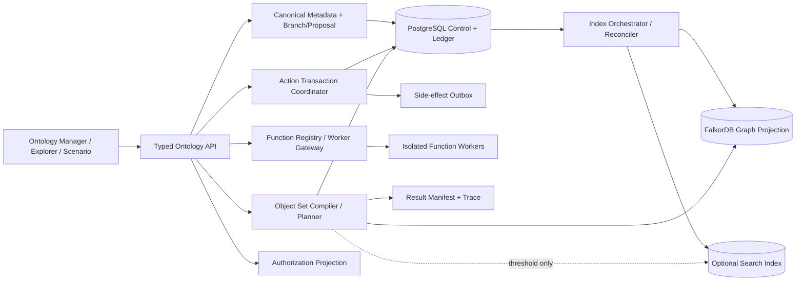

# Ontology Platform 总计划：语义底座、数据平面、治理与运行时

> 计划性质：长期主计划；每个阶段独立实施、迁移和验收，不是工期承诺。  
> 基准日期：2026-10-18  
> 上游审计：`docs/plans/PALANTIR_ONTOLOGY_PLATFORM_GAP_AUDIT_2026_10_18.md`  
> 参考风格：Plan A 负责底层真相与安全，Plan B 负责运行时和用户工作流；本计划延续该责任边界，并允许淘汰旧接口。  
> 用户决策：覆盖完整 Ontology Platform；制造业/供应链为主验证链，辅以跨行业数据；旧接口可淘汰，但必须先提供迁移、验证和回滚；新增服务必须经过 spike 与压力阈值。

## 1. 目标与不做事项

### 1.1 目标

建设一套可被 Scenario、Object Explorer、业务应用及未来 AIP 共同调用的 Ontology Platform。完成后：

1. Object Type、Property、Link Type、Interface、Shared Property、Value Type、Struct、Action Type 和 Function 都是具有稳定身份、不可变版本、依赖、权限、状态和变更历史的一等资源。
2. PostgreSQL 保存规范元数据、写入账本和控制状态；查询投影、图索引和搜索索引可重建，不成为第二真相源。
3. 所有对象和链接写入都通过同一 Action transaction contract；所有自定义计算都通过版本化 Function contract。
4. Object Query/Object Set 在 live、snapshot、scenario 和 branch 上具有明确一致性、权限、分页、成本和降级语义。
5. builder 可以通过 branch → proposal → review → rebase/conflict resolution → merge 安全修改 schema；业务用户通过 Scenario 隔离对象数据 edits，两者严格分开。
6. Ontology Manager 使用接近 Palantir 的资源管理信息架构，同时保留本项目自己的品牌和可维护组件边界。
7. 迁移、真实数据验证、边界测试、压力测试、可观测性和故障恢复是每个阶段的发布门禁。

### 1.2 不做事项

- 不复刻 AIP、Agent Studio 或模型训练平台；未来 AIP 只能通过受控 Object Query、Function 和 Action 接入。
- 不以 Map、Machinery、Vulcan、Dynamic Scheduling、Foundry Rules 等专业产品为交付目标；其中 Map 及 GeoPoint、GeoShape、空间查询和空间索引能力整体延期。
- 不声称复制 Palantir 私有后端；只实现官方文档和公开 SDK 可证明的产品契约。
- 不把图数据库、搜索引擎或工作流引擎暴露为公共 Ontology API。
- 不为了截图相似而重写已满足语义的代码。
- 不把真实数据、公开的合成数据、本项目生成的压力数据混称为同一种证据。

## 2. 当前仓库现实

### 2.1 应保留并扩展

| 当前能力 | 真实代码边界 | 处置 |
|---|---|---|
| canonical semantic resources | `models/v2/semantic_core.py`、`semantic_core_service.py` | **扩展**；成为唯一 schema truth |
| revision 与 migration | `ontology_revision.py`、`schema_migration_*` | **扩展**；增加 branch、完整 breaking-change instructions 和实例/edit 迁移 |
| 权限投影 | `security.py`、`authorization_service.py` | **扩展**；统一所有入口并拆分 resource/data/write authorization |
| Object Query/Object Sets | `services/v2/object_query/*`、`models/v2/object_set.py` | **保留并强化**；作为统一读取层 |
| 数据平面 manifest | `data_plane_service.py`、`ontology_materializer.py` | **扩展**；加入事务、offset、index lifecycle、reconciliation |
| Action/Function 骨架 | `models/v2/action.py`、`function_contracts.py`、`function_binding.py` | **重构**为单一写入协议和隔离 runtime |
| Scenario | `models/v2/scenario.py`、tracking/merge/workbench | **保留**；明确为 data-edit branch |
| Object Explorer/View | 对应 router、model、React 页面及 E2E | **保留**；作为底层验收消费者 |
| React Flow/Cytoscape/Table/Query Builder/ECharts | 已锁定或已安装 | **限定角色继续使用** |

### 2.2 必须收口或淘汰

- `/api/v1/.../entities`、旧 graph/edit 路径和直接写 `Entity`/`Relation` 的业务代码不得继续发展。
- `Entity.properties`、`Relation.properties`、散落的 JSON schema 只能作为迁移输入和兼容投影；不能继续作为 schema source of truth。
- `logic_assets.py` 中进程内 `EXECUTORS` 只能作为开发执行器，不能被宣称为生产 Function runtime。
- 目前部分 v2 routers 没有统一 `get_current_user` dependency；必须在迁移期列成安全阻断项。
- Ontology detail 的十余个平级 tab 混合 schema、data、runtime 和消费应用；必须拆成 Builder 与 Use 两条导航。
- FalkorDB、Neo4j、Chroma 同时存在但职责重叠。计划不继续扩大多后端写入；每个后端必须有明确 adapter owner、rebuild 和退出路径。

### 2.3 兼容决策

采用 **迁移后淘汰**，不承诺长期双栈：

1. 先发布 inventory/dry-run/export 工具，记录旧资源、实例、links、actions、views、scenarios 和调用方。
2. 生成 canonical target、stable-id map、validation report 和回滚包。
3. shadow 双读比对；双写只允许短期存在并有截止 revision。
4. 切换 canonical APIs，旧入口进入只读和告警期。
5. 达到验收后删除旧写路径；旧表保留一个明确回滚窗口，再归档。
6. 任何 destructive migration 必须支持原 revision 指针恢复、旧数据恢复和索引重建。

## 3. 证据台账

| 公开证据 | 支持的设计结论 |
|---|---|
| [Ontology overview](https://www.palantir.com/docs/foundry/ontology/overview/) | Ontology 同时包含 semantic 与 kinetic elements，不只是 schema/graph |
| [Ontologies overview](https://www.palantir.com/docs/foundry/ontologies/ontologies-overview) | Object/Link/Action/Interface/Shared Property/Group 是 ontology resources；ontology 与 space、organization 有治理关系 |
| [Branching the ontology](https://www.palantir.com/docs/foundry/ontologies/branching-ontology) | schema resource branch、保护、proposal、review、rebase/conflict、merge 是独立能力 |
| [Ontology scenarios](https://www.palantir.com/docs/foundry/ontology/overview-ontology-scenario) | Scenario 隔离 data edits、自动 rebase、Function/Action execution context；不同于 Global Branching |
| [Indexing overview](https://www.palantir.com/docs/foundry/object-indexing/overview/index.html) | batch/stream Funnel、direct datasource 和 object index 是独立数据平面 |
| [Data restrictions](https://www.palantir.com/docs/foundry/object-indexing/data-restrictions) | primary key、类型和质量限制在 indexing 阶段强制执行 |
| [Object edits](https://www.palantir.com/docs/foundry/object-edits/how-edits-applied) | live edit、offset/read-after-write、版本检查和持久 edit storage |
| [Materializations](https://www.palantir.com/docs/foundry/object-edits/materializations) | materialization 是 source + edits 的当前状态投影，不是源数据 |
| [OSDK Maker](https://github.com/palantir/osdk-ts/blob/main/packages/maker/README.md) | Object、Interface、Shared Property、Interface Link、Action 是强类型开发契约 |
| [OpenSearch PIT](https://docs.opensearch.org/latest/search-plugins/searching-data/point-in-time/) | 若采用 OpenSearch，稳定深分页需 PIT + search_after；不能把普通 offset 当 snapshot |
| [Temporal durable execution](https://docs.temporal.io/develop) | 长任务持久执行和 replay 可由成熟引擎提供，但引入成本必须经 spike 证明 |
| [OPA integration/decision logs](https://www.openpolicyagent.org/docs/integration) | 外部 policy engine 可分发 policy、报告状态和审计 decision，但不自动解决对象查询裁剪 |
| [OpenFGA](https://openfga.dev/) | 适合 resource relationship authorization；不能直接替代 row/property 条件投影 |
| [React Flow](https://xyflow.com/open-source) | MIT 的可编辑 node/edge UI；适合 schema/logic canvas |
| [Cytoscape.js](https://js.cytoscape.org/) | MIT、图分析和大图布局；适合 read-oriented object exploration |
| [Blueprint](https://blueprintjs.com/docs/) | Palantir 开源的高密度桌面 UI 组件；需要 React 19 兼容 spike |
| [TanStack virtualization](https://tanstack.com/table/latest/docs/framework/react/guide/virtualization) | virtualization 只优化 DOM，不代替服务端分页/过滤 |

所有 Palantir 条目表示公开产品契约，不表示其私有实现一定使用本计划中的组件。

## 4. 参考语义与不可破坏的约束

### 4.1 身份、定义和状态

- `resource_id` 永久稳定；`api_name` 是版本化 API identity，改名必须走 migration；display name 可普通编辑。
- `resource_version = (resource_id, metadata_revision_id)`，已发布版本不可变。
- `metadata_revision`、`data_snapshot`、`index_checkpoint`、`scenario_revision`、`branch_head` 是五种不同身份，不得共用一个 `version` 字段。
- canonical metadata、authoritative instance/edit ledger、query projection、search index、cache 是不同平面；后三者必须可从前两者重建。
- 删除资源先 retired/deprecated；只有 dependency 为零、迁移完成且回滚窗口结束后才能物理清理。

### 4.2 类型系统

- 一套 registry 描述 primitive、array、struct、value type、attachment/media、time series、cipher/reference 类型。
- 每种类型声明 source mapping、primary key、null、array、filter、sort、aggregate、full-text、Action parameter、SDK serialization 和 migration capability。
- Struct 不靠任意 JSON 冒充；field identity、约束和嵌套限制必须显式。
- Interface 是运行时多态 contract；implementation 必须通过 property mapping、link constraint 和 capability validation。
- Shared Property 复用语义；Value Type 复用基础类型与约束。两者不是复制字段的模板。

### 4.3 查询和一致性

- Object Set AST 保留操作顺序、AND/OR/NOT、relation direction、cardinality 和 multi-value policy。
- read request 必须指定或解析 `ExecutionContext`：live、snapshot、scenario 或 branch；返回 `ResultManifest`。
- cursor 绑定 query hash、sort、metadata digest、permission digest、data checkpoint 和 expiry；任一变化返回稳定 mismatch error。
- empty、unauthorized/not-found、unavailable、degraded、partial、stale 和 invalid query 是不同结果。
- 同一请求内读取同一 snapshot；live read-after-write 由 commit token/offset 保证。
- derived property 和 to-many traversal 不得静默选择第一项；必须 aggregate 或返回 cardinality error。

### 4.4 权限

- resource governance permission、object read permission、property/link projection、Action read authorization、Action write authorization 分开建模。
- deny 优先；没有 link allow 时不能仅凭两个端点可见推断 link 可见。
- aggregate、count、facet、trace、export、materialization 也必须经过同一 projection，避免侧信道。
- policy decision 记录 policy/version、principal、scope、outcome 和 trace id；日志不包含被遮蔽原值。
- permission change 使 cursor、cache 和 materialized user-specific result 失效。

### 4.5 Action 与 Function

- Action 状态机：`received → resolved → authorized → validated → prepared → committed → side_effects_pending → completed/partially_failed`。
- ontology edits 在一个事务中原子提交；外部 side effects 走 transactional outbox，明确 at-least-once 和 idempotency key。
- commit 前重新验证 write authorization、object versions、metadata revision 和 scenario/branch target。
- Function release 是 immutable artifact；调用 pin exact release，开发分支才允许 compatible range resolution。
- Function 本身不直接 commit 对象；返回 typed result 或 edit batch，由 Action commit。
- staged writes 只在 invocation context 内 read-your-writes；外部直到 commit 后可见。

### 4.6 Branch 与 Scenario

- Ontology branch 保存 resource changes 和 base metadata revision；Scenario 保存 object/link edit overlay 和 base data view。
- proposal 的 review/approval 针对资源变更；scenario merge Action 的 criteria 针对业务数据变更。
- rebase 使用三方比较；冲突必须保留 base/ours/theirs 和可解释 resolution，不能 last-write-wins。

## 5. Design corrections

| 先前假设 | 新证据 | 修正设计 | 对现有代码影响 | 动作 |
|---|---|---|---|---|
| canonical core 尚未实现 | 当前已有 stable resource/version/mapping | 不重建表；补足统一读写和生命周期 | 旧服务需改走 canonical API | **extend + migrate** |
| 权限只是占位 | 已有 allow/deny、row condition、field/link projection | 保留 evaluator，补齐资源治理和入口覆盖 | 所有无 auth dependency 的 router 必须接入 | **extend** |
| Schema Migration 缺失 | 已有 plan/run/instruction/shadow/revert | 扩展真实实例/edit/index migration，不另建第二框架 | 增加 instruction registry 和 recovery test | **extend** |
| Scenario revision 可承担 schema branch | 官方明确 Scenario 与 Global Branching 不同 | 建独立 ontology branch/proposal model | Scenario 保持数据 overlay | **preserve + add** |
| React Flow 可以承担所有图 | DOM 可编辑强，但大对象图职责不同 | React Flow 管 builder；Cytoscape 管 exploration | 保留两套但共享 graph view contract | **preserve** |
| virtualization 可以解决百万行 | TanStack 明确只优化已加载 DOM | 后端拥有 filter/sort/page/aggregate，前端只渲染窗口 | Object Explorer 禁止全量 fetch | **correct** |
| 新搜索/工作流/权限服务能直接解决平台问题 | 组件只解决局部基础设施 | 先定义 ontology contract，再用 threshold 触发组件 | adapter 后方接入，公共 API 不变 | **defer/spike** |
| 本地 executor 等于 Function runtime | 当前执行器无隔离、资源控制和 telemetry | 建 worker execution boundary；本地执行器只用于 dev | published Function 不再直接调用全局函数表 | **replace** |
| 所有旧 API 都应长期兼容 | 用户允许 breaking upgrade | 提供 inventory、migration、shadow verify、rollback 后删除旧写入 | 减少永久双栈 | **deprecate** |

## 6. 目标架构与责任边界

### 6.1 Plan A 责任：事实、语义、安全和迁移

- canonical resource/type registry、revision/branch、dependency graph；
- source mapping、instance/edit ledger、checkpoint/index lifecycle；
- authorization projection 和 resource governance；
- schema migration、legacy cutover、reconciliation 和 rollback；
- adapter contracts 和 generated frontend/SDK types。

### 6.2 Plan B 责任：查询、运行时和用户工作流

- Object Set compiler/planner/executor；
- Action coordinator、Function worker、side effects、logs/metrics；
- Object Explorer、Object Views、Scenario；
- Ontology Manager resource UX、proposal/review UX；
- browser E2E、demo scenarios 和 performance UX。

### 6.3 唯一集成合同

Plan B 只能使用 Plan A 发布的 `ResourceRef`、`MetadataSnapshot`、`ExecutionContext`、`AuthorizationProjection`、`DataCheckpoint`、`ResultManifest`、`EditBatch`、`MigrationRun`。不得在 UI、Scenario 或 Function 内复制权限、revision、source merge 或 stable-id 规则。

## 7. 开源组件决策矩阵

| 组件 | 决策 | 精确角色 | 项目仍需负责 | 采用/拒绝条件 |
|---|---|---|---|---|
| PostgreSQL 16 | **采用** | canonical metadata、ledger、outbox、control state | ontology semantics、事务编排、分区/归档 | 当前主数据源，继续使用 |
| FalkorDB | **窄角色采用** | relation traversal projection | canonical truth、权限、reconcile | 真实图查询 p95 和重建满足门槛才保留生产角色 |
| Neo4j | **停止扩大/候选淘汰** | 仅旧兼容或对照 benchmark | 数据同步成本 | 若无独有且被使用的 capability，迁移后移除 |
| Redis + Celery | **当前采用** | queue、短异步任务、beat | durable saga/replay | 长任务 crash/retry 测试失败或补偿复杂度超阈值时启动 Temporal spike |
| Temporal | **spike first** | migration/index/Function 等长任务 durable orchestration | ontology state machine、authorization | 仅当 30 分钟任务、进程重启、重试/取消无法由现有 checkpoint 稳定满足时采用 |
| OpenSearch | **defer pending threshold** | full-text、facet、PIT deep page | source truth、graph、permission post-filter 防泄露 | PostgreSQL/FalkorDB 在 1M objects 的指定搜索 SLO 连续失败后 spike |
| OPA | **reference / narrow spike** | policy bundle、通用 ABAC decision、decision log | query pushdown、field projection、resource graph | 仅在 policy language/version distribution 成为瓶颈时采用 |
| OpenFGA | **暂缓** | resource-level ReBAC 候选 | row/property conditions、large result filtering | 出现跨组织 resource sharing 和关系权限规模需求后再 spike |
| React Flow `@xyflow/react` | **采用** | schema/logic/function editable canvas | domain validation、ports/types、save diff | 已安装；限定可见节点预算，超限切 summary/virtual view |
| Cytoscape.js | **采用** | object relation exploration、布局和路径高亮 | server-side neighborhood limits | 已安装；不得承担 schema editor truth |
| TanStack Table v9 | **采用** | resource/results table state | server pagination/filter/sort | 已锁定；加入 TanStack Virtual 前先测 DOM 门槛 |
| React Query Builder | **采用窄角色** | visual filter → internal AST | metadata allowlist、type coercion、security | 第三方 AST 永不直接发送后端 |
| ECharts | **采用窄角色** | aggregate/time-series/scenario comparison | metric truth、sampling disclosure | dynamic import；不渲染完整对象集 |
| Blueprint v6 | **兼容 spike / reference** | Tree、Breadcrumb、Popover、Dialog、dense form/table 样式参考 | 信息架构、branding、React 19 compatibility | 选 3 个真实页面对比 bundle、a11y、CSS 冲突；失败则沿用现有 Tailwind primitives |
| OpenTelemetry | **采用标准，分阶段接入** | trace/metric/log correlation | domain event naming、PII redaction | Function/Action/Data Plane 必须产生同一 trace chain |

所有新依赖必须锁定精确版本、保存 license 清单和升级策略；不得使用 `latest` 作为验收镜像版本。

## 8. 分阶段实施计划

### Phase 0：基线、词汇和可重复环境

**交付**

- 固化 glossary：resource、revision、snapshot、checkpoint、branch、scenario、edit、materialization、projection、Action、Function。
- 生成 route/write-path inventory，标出所有直接写旧表、无认证 router、后端依赖和调用 UI。
- 固定 Docker validation compose 的 PostgreSQL/FalkorDB/Redis 镜像 digest；记录 CPU、内存、磁盘。
- 下载并登记真实数据 manifest、URL、license、retrieval date、SHA-256、行数、null/duplicate/key distributions。
- 记录当前 API、迁移、真实 Docker、E2E、lint/build 和压力基线；失败按 introduced/blocking/historical/environment 分类。

**门禁**：新机器运行一条命令能建立隔离验证栈；manifest checksum 匹配；baseline report 可重复；未修改产品语义。

### Phase 1：Canonical metadata 成为唯一真相源

**交付**

- 扩充 resource kinds：object/link/property/interface/implementation/shared property/value type/version/struct/field/action/function/group。
- 加 resource status、owner project、visibility、usage/dependency、protection、capability metadata。
- 创建 typed resource service 和 OpenAPI/JSON Schema；生成 Python/TypeScript types，CI 检查 drift。
- 所有 v2 metadata read/write 改走 canonical service；旧表改为单向 compatibility projection。
- inventory/dry-run/import/verify/export/rollback CLI；生成 stable-id map。

**迁移门禁**：在数据库副本上迁移 100% 旧资源；数量、身份、relations、source mappings、actions 和 scenario references 对账；随机与全量 hash 验证通过；回滚恢复旧 current revision；旧数据未被静默丢弃。

### Phase 2：完整类型系统、Interface 和 SDK contract

**交付**

- type registry/capability matrix；实现 arrays、struct、value type、media/attachment、geo、time-series 的分阶段支持。
- required、edit-only、derived、mandatory-control、render hints、primary/title key 和约束。
- Interface implementation validator、多态 Object Set、interface link constraint 和 interface Action target。
- Shared Property reuse/override 和 Value Type immutable constraint versions。
- 生成 SDK definitions 和编译时示例；禁止任意 JSON 绕过 registry。

**门禁**：每个支持类型通过 mapping → index → query → Action → serialization → migration round trip；不支持组合返回稳定错误；Interface Object Set 混合至少三种 concrete object types 并保持 field security。

### Phase 3：统一权限与资源治理

**交付**

- 拆分 resource permission、data read projection、Action read auth、write auth。
- 将 auth dependency 和 projection 接入 graph、object query、object sets/views、scenario、actions、functions、exports、materializations 和 audit。
- permission digest 驱动 cursor/cache invalidation；aggregate/facet 防侧信道。
- project/organization/group/resource grants、protection policy 和 masked decision audit。
- OPA/OpenFGA 仅做有数据的 spike，不改变公共 contract。

**门禁**：入口矩阵全部通过；同一 principal 在所有入口看到相同 object/property/link；权限变更后旧 cursor/cache 拒绝；denied values 不出现在 response、trace、log、error 或 aggregate。

### Phase 4：Object data plane 与索引生命周期

**交付**

- `SourceTransaction`、`ObjectEdit`、`DataCheckpoint`、`IndexJob`、`ProjectionState`、`Materialization` 模型。
- batch ingest：validate → changelog → merge source/edit → index → checkpoint → reconcile。
- streaming ingest：partition/order key、late/out-of-order policy、dedupe、dead-letter、watermark。
- object version、commit token 和 read-after-write；multi-source column merge 与冲突报告。
- projection rebuild 使用 shadow namespace；验证后原子切换；PostgreSQL ledger 可独立重建 FalkorDB。
- 管理 UI 显示 freshness、lag、last success、error、retry、checkpoint 和 materialization lineage。

**门禁**：Docker 中断 backend/worker/FalkorDB 后恢复；无重复/丢失 edit；commit 后携 token 的读取必见；故意破坏 projection 能检测并重建；真实数据数量与 ledger/index/materialization 三方一致。

### Phase 5：Object Set planner 与规模执行

**交付**

- 统一 recursive AST、structural/domain validation、cost estimate 和 explain。
- adapter capability negotiation；SQL pushdown、graph traversal、bounded in-memory aggregation；不支持时明确 unavailable。
- snapshot cursor、stable sorting、null/array/cardinality/aggregate 语义。
- async query、cancel、timeout、budget 和 partial-result policy。
- OpenSearch spike 使用真实 1M dataset，比较 PostgreSQL FTS/trigram 和 OpenSearch PIT；未达到触发阈值不部署。

**门禁**：known-answer queries 跨 adapter 一致；同 snapshot 翻页无重复/遗漏；metadata/permission/data 改变使 cursor 拒绝；取消后资源回收；1M 数据达到本阶段 SLO。

### Phase 6：Transactional Action runtime

**交付**

- Action definition：typed parameters、visibility/editability/default/filter、rules、criteria、effects、side effects、limits。
- coordinator 状态机、idempotency、object-version conflict、atomic edit batch、scenario target 和 revert eligibility。
- transactional outbox、side-effect worker、retry/backoff/dead-letter、补偿说明。
- Action Log、edit history、metrics、monitoring 和 revert 分开存储与展示。
- 删除绕过 Action 的对象/链接业务写路径。

**门禁**：kill -9 在 prepare/commit/outbox 各点注入；ontology edits 要么全有要么全无；side effect 可重试但不重复产生业务效果；越权、旧版本、超限和 function failure 无 live write。

### Phase 7：版本化、隔离和可观测的 Function runtime

**交付**

- Function definition/release/artifact/interface/usage/dependency/permission 模型。
- 开发执行器与 published worker 分离；artifact digest、exact pin、compatibility validation。
- worker sandbox：CPU、memory、wall time、output、concurrency 和 network egress policy。
- typed Object Set read、nested call、edit batch、staged writes。
- OpenTelemetry trace/log/metric；输入值和 masked fields 不进入 telemetry。
- Celery 与 Temporal spike 对同一 crash/retry/cancel workload 比较；按阈值决策。

**门禁**：不同 release 可重复运行；超时/OOM/网络拒绝有稳定状态；worker restart 可恢复或安全失败；nested staged write read-your-writes，外部在 commit 前不可见；P95 和资源量可查询。

### Phase 8：Ontology Global Branching 与 Proposal

**交付**

- `OntologyBranch`、`ResourceChange`、`Proposal`、`ReviewTask`、`Approval`、`Conflict`。
- protected resource 强制 branch；working changes、diff、comments、review policy。
- three-way rebase、dependency-aware conflict 和 per-resource resolution。
- approved proposal 原子推进 main metadata revision；触发 migration/index rebuild 时显示 gate。
- Scenario 继续使用 data overlay，两种 branch 在 API、数据库和 UI 都不复用类型。

**门禁**：两个用户并行改相同/不同资源；无冲突变更自动合并，有冲突变更必须人工解决；未满足 approval/protection/migration gate 不能 merge；失败后 main 不移动。

### Phase 9：Palantir 风格 Ontology Manager UI

**信息架构**

- 一级：Ontology Manager（Build）与 Ontology Applications（Use）。
- 左侧资源树：Object Types、Link Types、Action Types、Interfaces、Shared Properties、Value Types、Functions、Groups。
- 中间资源页：Overview、Schema/Properties、Datasources、Security、Capabilities、Usage/Dependencies、History。
- 顶部：status、branch、protection、revision、save；右侧：working changes、validation、impact、review。
- Object Explorer、Object Views、Scenario 从 Use 入口进入，仍可深链返回资源。

**交互与组件**

- React Flow：schema/logic canvas，typed ports、drag/drop、keyboard connect、invalid edge explanation、minimap、fit/zoom、undo/redo、diff overlay。
- Cytoscape：只读对象探索，server-bounded neighborhood、path highlight、progressive expansion。
- TanStack Table：服务端 sort/filter/page，column visibility/pin，必要时 TanStack Virtual。
- Query Builder：metadata-driven operator、nested groups、URL/save restoration。
- Blueprint spike：Tree/Breadcrumb/Dialog/Form 三个切片；React 19、bundle、CSS、a11y 通过才采用，否则用现有 Tailwind primitives 复刻布局。

**门禁**：一名不了解项目的本科生能按任务脚本创建 object/link/interface/action、绑定数据源、查看影响、提交 branch proposal 并在 Explorer 验证；全程无技术内部字段阻碍；键盘主路径、1280×720 与 1920×1080 可用；刷新/后退/深链恢复状态。

### Phase 10：Legacy cutover 与删除

**交付**

- 发布迁移窗口、版本兼容表和 rollback runbook。
- shadow dual-read 比对真实 ontology；差异按资源/对象/查询/权限分类。
- UI 和 SDK 切 canonical endpoints；旧 API 返回 deprecation headers 和迁移链接。
- 冻结旧写入，最终增量迁移，切 current pointers，重建 indexes/materializations。
- 回滚窗口后删除旧 router/write service；旧表只读归档，下一版本物理移除。

**门禁**：至少两次完整 dress rehearsal；零未解释 diff；备份恢复实测；rollback RTO 达标；Scenario、Explorer、Action、Function 和公开 demo 全部通过 canonical path。

### Phase 11：容量、韧性和生产准备

**交付**

- 1x/5x/20x 三档本机与目标环境 profile；concurrency、soak、restart、disk pressure 和 dependency outage。
- SLO dashboard、alerts、runbooks、retention/partition/backup、capacity model。
- architecture-review checkpoint：同范围测试若出现三个以上不同失败或同一缺陷类反复两次，暂停依赖该边界的补丁，检查 ownership/contract，不自动重写全仓库。

**门禁**：达到第 11 节 SLO；8 小时 soak 无持续内存增长、队列堆积和错误率上升；依赖恢复后自动 reconcile；备份恢复和 schema rollback 再次实测。

## 9. 真实数据验证方案

### 9.1 固定数据集

| 数据集 | 性质与许可 | 规模 | 用途 | 已知断言 |
|---|---|---:|---|---|
| [UCI Online Retail II](https://archive.ics.uci.edu/dataset/502/online%2Bretail%2Bii) | 真实 UK 零售交易，CC BY 4.0，DOI `10.24432/C5CG6D` | 1,067,371 transactions | Customer/Invoice/Product/Country，取消、缺失、时间、金额、百万级搜索/聚合 | `InvoiceNo` 以 `C` 开头表示 cancellation；导入后核对总行数、unique invoices/products/customers、null CustomerID |
| [UCI Steel Industry Energy Consumption](https://archive.ics.uci.edu/dataset/851/smart%2B) | 工业能耗观测，CC BY 4.0 | 下载后 manifest 记录 | 时间序列、能耗、tariff、排产成本、类型/单位 | 本仓库已有 CSV 与 manifest；重新核验来源 checksum、行数和分类分布 |
| [NASA C-MAPSS](https://www.nasa.gov/intelligent-systems-division/discovery-and-systems-health/pcoe/pcoe-data-set-repository/) | 高保真模拟 run-to-failure；公开来源，许可字段未明确，内部验证使用并保留 attribution | FD001–FD004 多机多周期 | Asset/SensorReading/FaultMode、time series、maintenance Action、large traversal | 每个 unit cycle 单调；官方 train/test trajectory 数与 manifest 一致；不得称为真实观测 |
| 当前 frePPLe demo | 开源计划系统示例数据，非现实观测 | 导入后记录 | BOM、supplier、operation、resource、order、alternate source | 明确标记 public demo/synthetic；用于可解释 known-answer planning fixture |

若数据源下载内容或许可变化，Phase 0 阻断并记录替代数据集；不得从不明镜像下载后冒充官方版本。每份数据保留 `source_url/retrieved_at/license/sha256/size/rows/schema/profile`，CI 使用小切片，Docker acceptance 使用完整数据，测试后按 namespace 删除。

### 9.2 合成压力数据

合成数据只扩大已验证 schema，不冒充真实数据：

- S：100k objects / 300k links / 10 object types；
- M：1M objects / 5M links / 30 types / 10 concurrent users；
- L：5M objects / 25M links / 100 types，仅在更大环境运行；
- skew：1% supernodes、20% null、1% duplicate source keys、late events、hot objects、wide objects、large arrays。

生成器固定 seed、版本和 expected counts；每次 run 使用独立 ontology namespace 并提供 cleanup。

## 10. 业务问题测试：从简单到复杂

| 级别 | 真实业务问题 | 数据与路径 | 正确性断言 |
|---|---|---|---|
| L0 | “某客户最近买了什么？哪些交易被取消？” | Online Retail：Customer → Invoice → Line → Product | cancellation 规则、缺 CustomerID、负 quantity、timezone、分页无重复 |
| L1 | “哪个国家/产品类别贡献销售额最高？” | Online Retail aggregation | `Quantity × UnitPrice`、取消排除策略、null/negative 显式、权限后 aggregate 不泄露 |
| L1 | “哪个时段能耗最高，峰/平/谷成本如何？” | Steel Energy time series | unit/type validation、时区边界、tariff version、空窗口与重复 timestamp |
| L2 | “设备是否需要维护，哪些传感器支持结论？” | NASA C-MAPSS | unit/cycle 顺序、RUL/fault evidence、Function release、Action criteria、trace provenance |
| L2 | “某来料批次异常会影响哪些下游批次和订单？” | frePPLe/BOM fixture + lot genealogy | multi-hop direction、cycle guard、shared component、partial quantity、召回 Action object versions |
| L3 | “关键供应商停供两天，会缺哪些料？有无替代来源？” | Supplier → Part → BOM → Product → Order；Scenario overlay | calendar/timezone、inventory safety stock、alternate qualification/lead time/MOQ、无替代与多替代排序 |
| L3 | “订单突然增加，现有产能能否按期完成？” | Orders + Operations + Resources + calendars | finite capacity、changeover、maintenance downtime、bottleneck、late orders、feasible 与 optimal 分开 |
| L4 | “停供后启用替代采购并重排产，哪些订单仍会延期，成本增加多少？” | supplier outage → multi-level BOM → alternate purchase → schedule → delivery | Scenario 固定 base、Action edits、nested Functions、成本/交期双目标、infeasible explanation、merge criteria |
| L4 | “需求翻倍且电价进入峰段，批次、能耗和交期如何共同变化？” | frePPLe planning + Steel Energy tariff | batch-size nonlinear cycle、resource/energy constraints、单位换算、Pareto alternatives、结果 provenance |
| L5 | “生产运行中修改属性类型、权限和 Action 定义会发生什么？” | 完整 ontology + concurrent workload | branch/proposal、migration blockers、old cursor/function/action pins、no mixed revision、rollback |
| 跨行业 | “零售客服只能看本区域客户，但财务可看聚合；取消订单后库存和报表如何一致？” | Online Retail | row/property/resource permissions、Action write auth、outbox、materialization freshness |

每个问题必须保存：输入 context、metadata/data revision、query/function/action versions、expected answer、允许误差、result manifest、trace、截图和 cleanup。优化/预测类结果不能只断言“有输出”，需要 feasibility constraint、known lower/upper bound 或与独立 reference solver 对照。

## 11. 综合测试矩阵与验收指标

### 11.1 测试层映射

| 层 | 真实依赖 | 重点 |
|---|---|---|
| Unit | 无外部服务 | type registry、AST、cardinality、policy precedence、cursor signing、state machines、migration instruction |
| Contract/component | real compiler/service，adapter 可替身 | router envelopes、generated types、UI state、错误码、Action prepare、Function binding |
| Integration | PostgreSQL 16、Redis、FalkorDB、MinIO、worker | transaction、projection、restart、reconcile、auth、migration、outbox |
| E2E | 完整 validation compose + Chromium | builder → data → query → Action/Function → Scenario/branch → UI result |
| Data acceptance | 完整公开数据 | counts/distributions/known answers、provenance、cleanup |
| Performance | 完整服务和 S/M/L fixtures | latency/throughput/memory/CPU/index size/recovery |

### 11.2 必测边界

- empty ontology、empty object set、all-null property、missing title/primary key；
- duplicate keys、invalid UTF-8、超长字符串、NaN/Infinity、decimal precision、DST、leap day；
- arrays empty/null/duplicate、struct missing field、unsupported nesting、geo invalid shape；
- self-link、cycle、parallel links、dangling link、many-to-many supernode、3-hop+ traversal；
- concurrent edit、stale object、stale metadata、permission change、expired/replayed cursor；
- Action 0/1/max/max+1 objects、payload bytes、batch calls、nested Function depth；
- Function timeout/OOM/crash/invalid output/network denied/release removed；
- branch delete-vs-edit、rename-vs-reference、source mapping change、migration during active query；
- queue unavailable、graph unavailable、DB restart、worker restart、partial side-effect outage、disk full；
- refresh/back/forward/deep link、double click/retry、slow/failed request、expired session、403/404 indistinguishability；
- keyboard connect/delete/undo、focus order、screen-reader labels、narrow desktop viewport。

### 11.3 初始 SLO 与测量门槛

以下是本机 Docker 的初始目标，Phase 0 测得基线后只能通过 ADR 调整：

- metadata/resource GET：p95 ≤ 200 ms，p99 ≤ 500 ms；
- 单类型 filtered object query（1M objects，page 100）：p95 ≤ 800 ms，p99 ≤ 2 s；
- bounded 2-hop traversal（返回 ≤ 1,000 nodes）：p95 ≤ 1.5 s；
- Action apply（≤100 edits，无外部 side effect）：p95 ≤ 1 s；
- commit token read-after-write：99.9% ≤ 2 s，零旧值成功响应；
- Function warm invocation：p95 ≤ 2 s；cold start 独立报告；
- index catch-up：100k changed objects ≤ 5 min；恢复后无 unexplained divergence；
- 10 并发用户 30 分钟：错误率 <0.5%，无持续内存增长；
- UI interaction：资源切换/过滤本地响应 <100 ms；长任务必须显示 progress/cancel；
- migration rollback：S fixture RTO ≤ 15 min；RPO=0 对已确认 canonical writes。

**组件触发阈值**：PostgreSQL/FalkorDB 在相同 fixture、索引和 query contract 下连续三次无法达到搜索 SLO，且 explain 证明瓶颈不可通过合理 schema/index 修复，才进入 OpenSearch adoption；Celery checkpoint 在三种 kill-point 下无法安全恢复或实现成本超过独立 durable engine，才进入 Temporal adoption。

### 11.4 前端自动化

Playwright 必须断言业务结果、网络响应、URL state、console errors 和截图，不只检查元素出现：

1. 创建资源并保存 working changes；
2. 建 branch/proposal/review/merge；
3. 导入真实数据并观察 index status；
4. Object Explorer filter/sort/page/traverse/save view；
5. Action valid/invalid/stale/denied/retry；
6. Scenario create/edit/compare/rebase/conflict/merge；
7. refresh、back/forward、deep link、慢网、服务不可用和恢复；
8. 记录 JS heap/DOM nodes/request count，反复切换 100 次无单调增长或重复请求风暴。

### 11.5 静态与构建门禁

- `npm run lint:src`：changed files 0 errors / 0 warnings；最终全仓库 0/0。
- `npm run lint:scripts`：0 errors / 0 warnings；验证 TSX、spec、JS、MJS 均被正确 parser/config 覆盖。
- `npm run build`：通过；记录 main/chunk sizes，ECharts/graph/builder 保持 lazy chunks。
- 后端执行对应 Python compile/import、Alembic heads/check、pytest scoped suite，再运行完整 suite。
- 不使用全局 disable、扩大 ignore 或 `|| true` 让门禁变绿；历史问题单独登记 owner 与删除条件。

### 11.6 故障分类与架构复审

每次 comparable run 固定 compose、fixture、seed、auth mode 和版本。失败分为：本阶段引入、已有但阻断、无关历史、环境/fixture/migration/auth mismatch、待分类。若相同 defect class 修复后再次出现，或相同范围累计三个不同 cross-boundary failure，暂停依赖该边界的实施，记录 reproduction、root cause、ownership、local fix vs shared refactor、迁移/回滚和恢复门禁。

## 12. 风险、延期项和待证问题

| 风险/未知 | 控制 |
|---|---|
| 当前工作区存在大量未提交 Scenario 变更 | 计划实施前建立可恢复基线；不得 reset/覆盖；每阶段按依赖合并 |
| PostgreSQL、FalkorDB、Neo4j 多份语义 | canonical ledger + adapter manifest + reconciliation；逐步淘汰无 owner 后端 |
| Blueprint 与 React 19/CSS 不兼容 | 只做三个切片 spike；失败则 reference only |
| NASA 数据许可未明确 | 只做内部验证并 attribution；发布 fixture 前完成许可复核或替换 |
| 真实 BOM/供应商数据难公开 | frePPLe 明确标为 demo/synthetic；不把它描述为真实企业记录 |
| 本机只有约 7.5 GiB Docker memory | S/M 档分开执行；OpenSearch/Temporal spike 不与全栈同时常驻；L 档移至更大环境 |
| breaking cutover 影响演示 | 两次 dress rehearsal、shadow compare、rollback bundle；切换前冻结 demo revision |
| UI 复刻侵入底层语义 | UI 仅通过 typed APIs；截图用于布局，不作为后端设计证据 |
| 性能优化导致权限泄露 | permission-aware plan/cache key；aggregate/export/search 全部进入入口矩阵 |

延期：AIP、自然语言 ontology 生成、跨组织 federation、移动端、全球多区域 active-active、完整 Machinery/Vulcan/Dynamic Scheduling 产品，以及 Map 和全部地理空间类型、查询、索引与 UI。只有重新立项后才将地理空间能力加入实施计划。

## 13. 决策摘要

- **保留**：canonical semantic core、revision/migration、authorization projection、Object Query/Object Sets、Scenario、Object Explorer/View，以及已经验证的前端组件边界。
- **实施前必须改变**：canonical truth 收口、五种版本身份分离、所有写入归一到 Action、Function 隔离、权限入口矩阵、Scenario 与 schema branch 分离。
- **批准组件角色**：PostgreSQL 作事实/账本；FalkorDB 作可重建图投影；React Flow 作编辑画布；Cytoscape 作对象探索；TanStack/Query Builder/ECharts 作受控 UI facade。
- **条件组件**：Blueprint、Temporal、OpenSearch、OPA/OpenFGA 必须通过兼容性或阈值 spike；不能先安装再寻找用途。
- **第一实施阶段**：Phase 0 可重复基线与 Phase 1 canonical cutover 工具；在迁移 inventory、真实数据 manifest、route/write-path inventory 和 rollback rehearsal 完成前，不进入 UI 重构。
- **进入后续阶段的证据**：每阶段的真实 Docker integration、真实公开数据 known answers、browser E2E、边界/故障注入、性能分位数、migration/rollback 和零新增 lint/build 问题。
