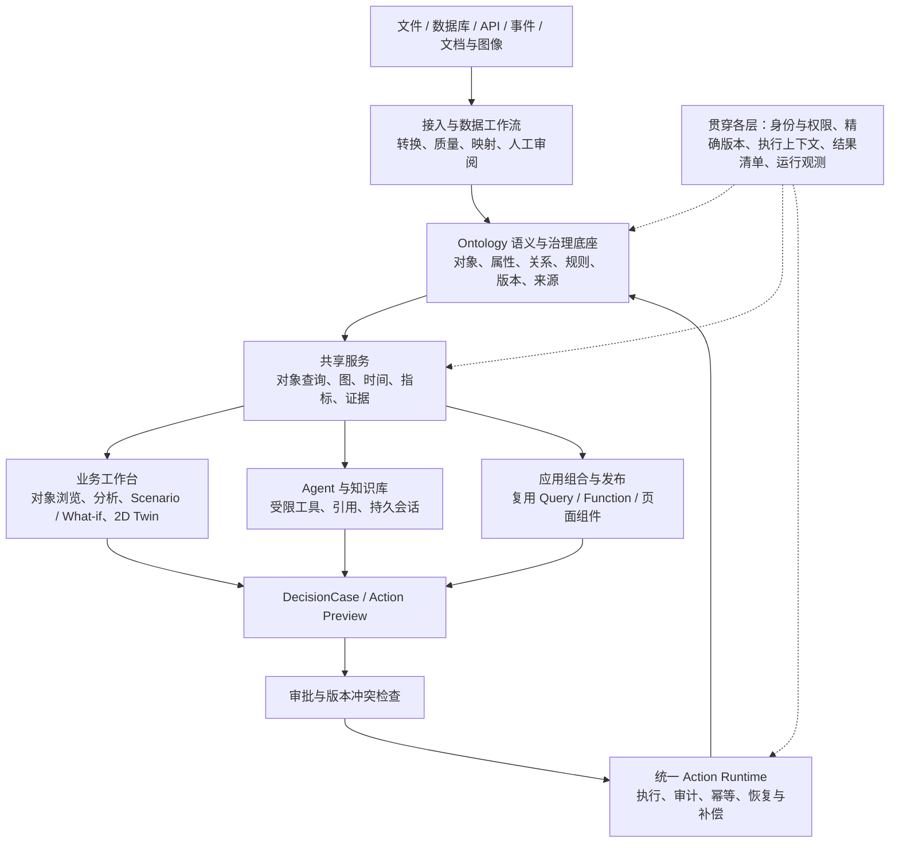

# Project 4 方案速读与当前基线说明

整理日期：2026-10-24。当前代码参照：`bdaec33`；本次为文档与源码入口静态核对，未运行功能验收。

## 原稿与用途

[组员方案原文](PROJECT4_PLAN_A_2_0_BASELINE_MASTER_ROADMAP_AND_PRD.md)为 nihou 的 v1.1 路线图与 PRD，从 Downloads 原样复制保存，SHA-256 已核对一致。它是系统整体方案的讨论输入，尚不代表当前已批准的范围、架构决定、工期或实现状态。OntoAct 不属于本次整理范围。

原文基于 `plan-a-2.0@7ab1cd1`，与当前合并仓库进度存在差异。原文关于重新 checkout、分支管理、迁移和双方签收的内容属于方案建议，不作为本次操作指令，也不取代现有计划或集成合同。

## 一句话理解

面向制造与供应链，把多源数据转成可追溯的业务对象，支持查询、关系与时间分析、What-if 比较，并将建议经预览和审批转成可审计、可恢复的执行。

## 整体架构

以下是原稿提出的目标架构，不表示各模块已全部落地。

**数据分工：** PostgreSQL 是业务状态、版本、运行与审计的事实权威；MinIO 保存原始与媒体资产；FalkorDB 是可重建的图投影；Chroma/向量索引负责候选召回。原稿强调图、向量和缓存不能独立定义业务事实。

**连接各模块的关键：** 同一对象的稳定身份（ObjectRef / ResourceRef）、调用主体与服务端授权、固定数据/本体/工具版本、ScenarioContext、ResultManifest 和 EvidenceRef。它们确保不同页面、后台任务和 Agent 对同一件事有一致理解。

## 最值得关注的设计要求

1. 数据与 LLM 映射先形成候选，经质量检查和人工审阅后发布；数据增量与 schema 变更分开处理。
2. 查询、图、历史时间与 Scenario 使用一致的版本和权限；推演与真实业务写入隔离。
3. 接受建议先形成决策案例或操作预览，真实副作用经统一执行入口；审批绑定具体输入、版本和预览结果。
4. Agent 要有持久会话、受限工具、来源引用和故障续接，重试不能重复执行副作用。
5. 页面复用已发布的 Query、Function、对象与 Action，避免每个业务应用复制一套后端语义。
6. 完成标准是可复现业务闭环和错误/权限/恢复验证；页面存在、HTTP 200 或源码存在均不足以证明交付完成。

## 路线图怎么读

| 阶段 | 主要解决的问题 |
|---|---|
| M0 | 确认实际起点、已有能力、范围、数据准入、负责人和估算 |
| M1 | 统一身份、版本、权限、执行与结果合同 |
| M2 | 数据到本体：建模、工作流、质量、LLM 候选与增量 |
| M3 | 业务对象搜索、详情、图和共享工作区 |
| M4 | 决策案例与受控 Action 生命周期 |
| M5 | 时间语义、Scenario、指标、影响链和 2D Twin |
| M6 | 可组合、可发布的业务应用 |
| M7 | 持久 Agent、知识库、工具与可复用能力发布 |
| M8 | 治理、监控、容量、备份、恢复与生产准备 |

这些是逻辑阶段，不是已承诺的日历排期。原稿以木材 Supplier Study 的 Baseline/B/C 作为首条业务回归路径；当前项目还有缺料决策和 Machinery 路径，最终主验收场景应按当前系统重新选择。

## 与当前合并进度的主要差异

以下“已有”只表示 README 描述或代码入口存在，不表示满足原稿全部验收条件。

| 原稿中的规划 | 当前可见依据 | 对后续计划的影响 |
|---|---|---|
| 从 Plan A 2.0 单独建立新基线 | 根目录 README_zh 已描述 Plan A/B 集成、Plan A 2.0 和决策层 | 应以当前确认的合并 SHA 重新盘点，不能直接照搬旧基线流程 |
| M1 共享语义与上下文 | `backend/app/services/v2/semantic_core_service.py`；`backend/app/schemas/v2/semantic_core.py` | 先核对现有合同覆盖与兼容问题 |
| M3 对象查询与 M5 情景 | `backend/app/services/v2/object_query/`、`scenarios.py`、`scenario_tracking.py`；前端 What-if 页面 | 属于复用、补齐和验收问题，不能全部按新模块估算 |
| M4 决策审批与恢复 | `backend/app/services/v2/decision_packages.py`、`scenario_actions.py`；`frontend/src/pages/what-if/DecisionPackagePanel.tsx` | 现有决策包与情景合并必须先核对，再判断是否要增加 DecisionCase 抽象 |
| M6 应用组合、FR-09 共享 Query | `805d71b` 增加版本化 Ontology Query；`bdaec33` 增加 Query Library、应用查询来源及 schema 绑定；`frontend/src/pages/workshop/` | 这部分已明显超出原稿基线快照，下一步重点应是生命周期和集成覆盖 |
| M7 持久 Agent 与知识生命周期、M8 生产准备 | 本次没有逐项验收这些完整要求 | 保留为待核查范围，不依据已有 Agent 页面推断完成 |

## 用于系统整体 TTP 的组织建议

此处保留用户的 TTP 称谓，不预设其缩写含义。若用于编写系统总体方案，可按“业务闭环 → 分层架构 → 核心数据与接口合同 → 已有能力/缺口 → 分阶段交付 → 验收与风险”组织；本稿可作为阅读入口，原稿提供详细能力目录和验收剧本。

建议优先读原稿第 0、2 节把握产品；第 18、21 节把握接口与架构约束；第 5、17 节了解建设顺序；第 19 节了解如何证明完成。详细页面矩阵位于第 20 节。

完整 3D Builder、通用多租户 SaaS、任意插件/脚本市场、广泛商业连接器市场和无界 Agent 自治均不应直接作为本期承诺。当前最有价值的下一步是针对现有合并代码做需求—实现—验收证据映射，再缩出实际剩余工作。
