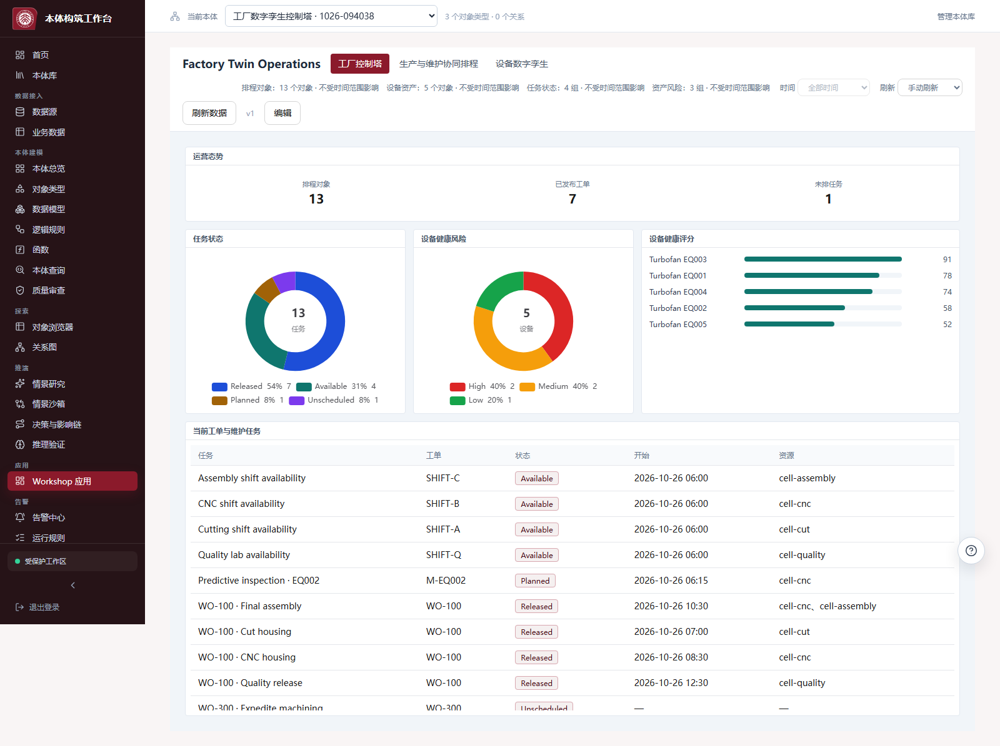
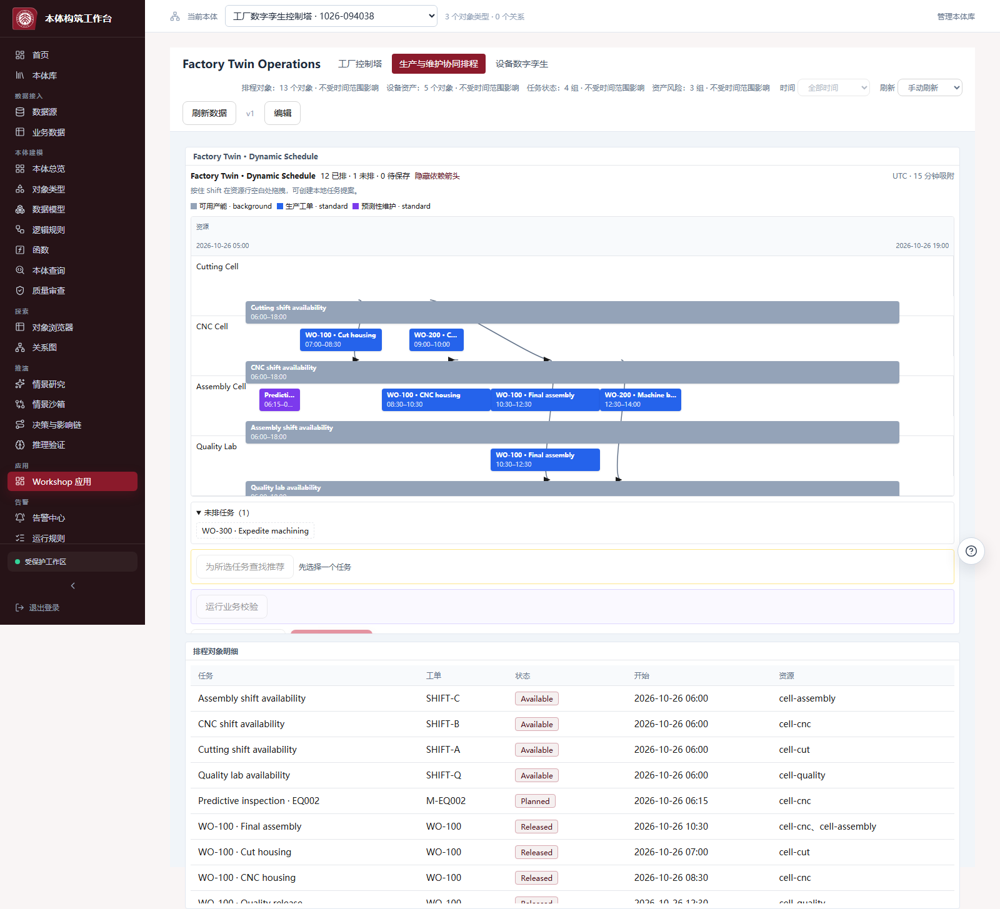
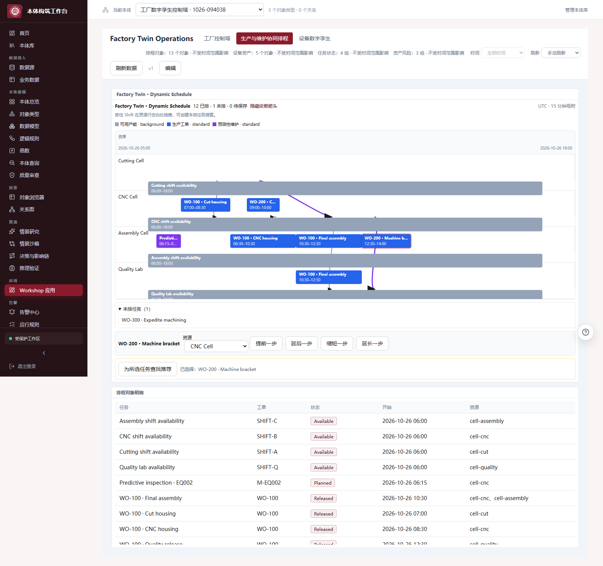
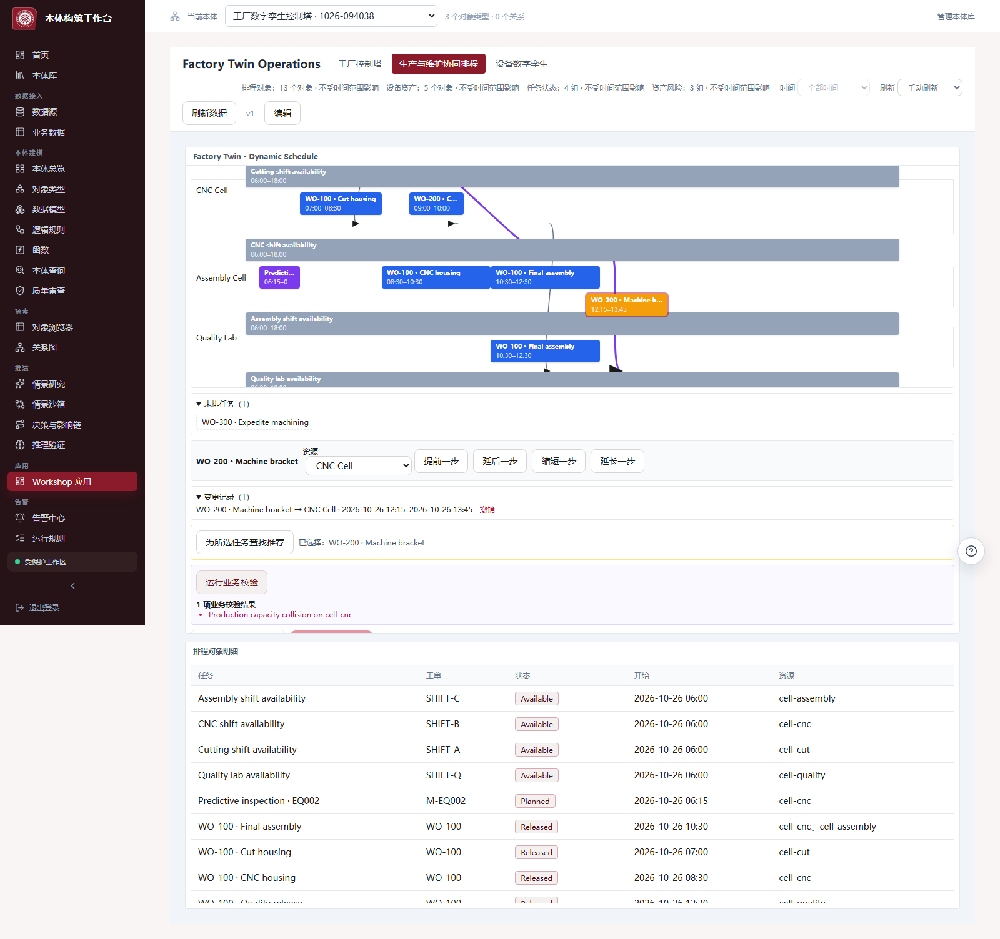
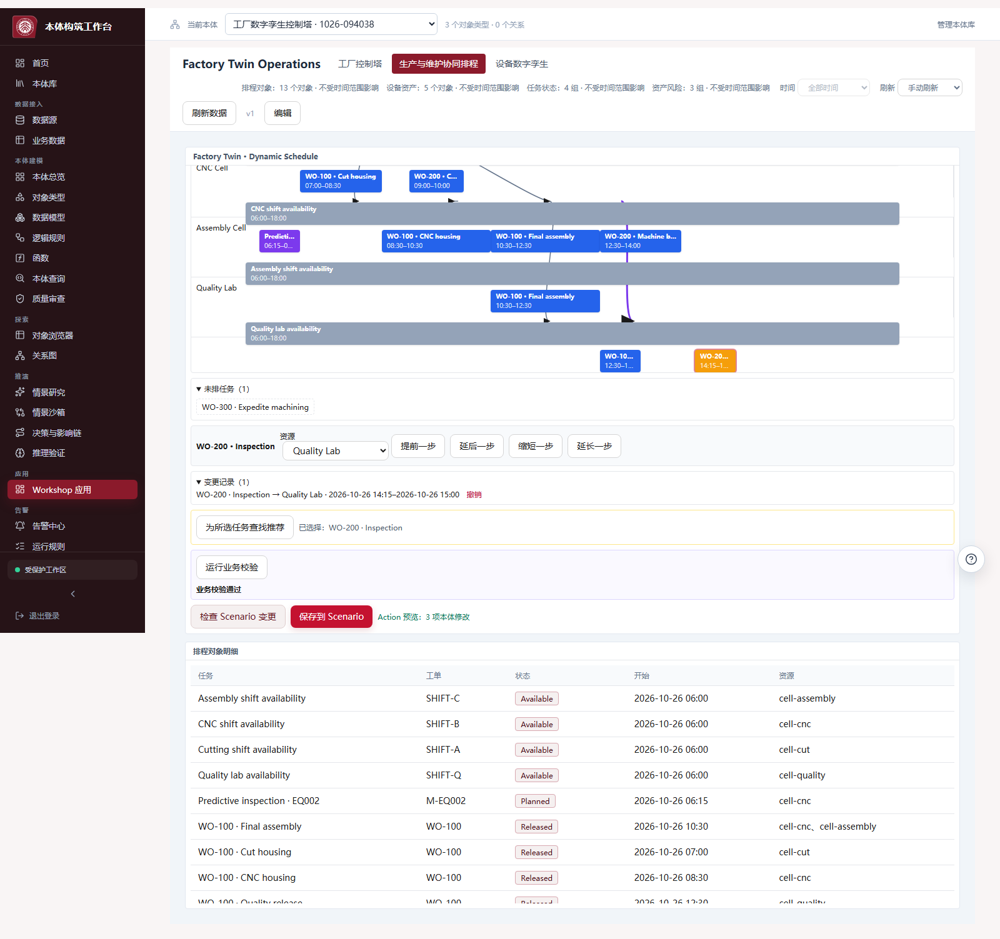
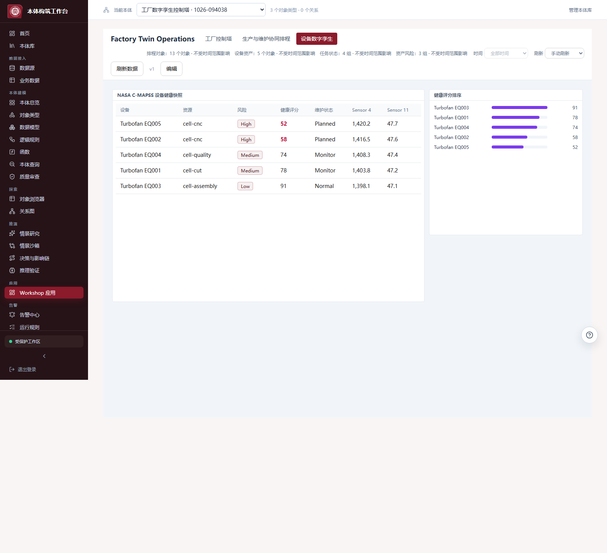
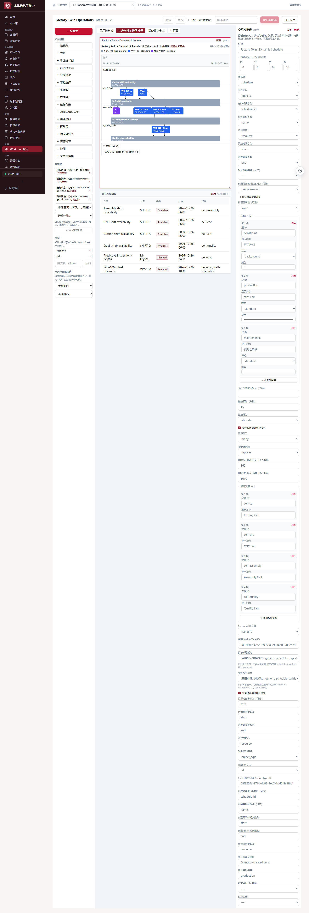

# 工厂数字孪生控制塔：完整演示 Guide

更新日期：2026-10-26

## 1. 你要展示的故事

这是一个“设备健康风险驱动生产与维护协同排程”的工厂数字孪生演示。它参考 Palantir 官方 [Lear JIT Production](https://www.youtube.com/watch?v=-DPdyQR1bG4) 的操作结构，以及 Foundry 的 [Dynamic Scheduling](https://www.palantir.com/docs/foundry/dynamic-scheduling/scheduling-overview) 契约：业务人员先看到工厂态势，进入资源排程，查看依赖和推荐，制造一个约束冲突并看到系统阻断，再提交一条有效改排到 Scenario 预览。

它不是静态 UI mock：页面读取真实本体快照；推荐和业务校验调用已发布的用户 Function；预览调用已发布 Action；Scenario 使用实时 ETag。资产页使用本地固定的 NASA C-MAPSS FD001 子集；生产排程是确定性演示数据，不能描述为真实工厂历史。

演示地址：

[打开 Factory Twin Operations](http://localhost:15173/apps/workshop/dea63459-3064-4385-83c7-acb3b5f47daf?ontology=6681e0bf-a289-40e0-b6c5-b823186b3198)

登录：`admin` / `admin123`

建议使用 1440×900 或更大的浏览器窗口，缩放保持 100%。完整演示约 7–10 分钟。

## 2. 一句话开场

> 这不是针对某家工厂写死的看板。平台把任意客户数据映射成资产、资源和排程对象，再通过配置化 Workshop、可发布 Function、Action 和 Scenario 组装应用；换数据集时替换映射和配置，不改平台代码。

## 3. Step 1 — 工厂控制塔

打开链接后停留在“工厂控制塔”。指出页面同时呈现：

1. 13 个排程对象，其中 7 个已发布工单、1 个未排任务。
2. 设备健康风险分布与健康评分排行。
3. 生产任务、维护任务和资源可用性在同一对象语义下展示。
4. 顶部明确显示每个数据源的对象/聚合数量和刷新方式。

推荐讲法：

> 管理者先看影响和异常，不需要先理解模型节点。这里把设备健康、生产状态和未排任务放在同一运营语境中；下一步从风险进入可执行排程。



## 4. Step 2 — 打开生产与维护协同排程

点击顶部“生产与维护协同排程”。指出：

- 灰色是可用产能背景层；蓝色是生产层；紫色是预测性维护层。
- 每一行是配置的资源，不是代码里的固定产线。
- 黑色箭头表示工序前置依赖。
- `WO-100 · Final assembly` 同时出现在 CNC 与 Assembly 两行，证明同一任务可以链接多个资源。
- 下方 `WO-300 · Expedite machining` 没有资源和时间，因此进入未排任务抽屉，没有被静默丢弃。



## 5. Step 3 — 选择任务，展示影响链

点击蓝色任务 `WO-200 · Machine bracket`。

你会看到：

- 任务出现选中描边。
- 与它有关的依赖链变成紫色。
- 下方出现资源、提前、延后、缩短、延长控件。
- 推荐区域显示当前选择对象。

推荐讲法：

> 用户操作的是本体里的一个排程对象。任务标识、资源、开始结束、前置任务和层全部来自字段绑定；这里没有 WO-200 或 CNC 的前端分支。



## 6. Step 4 — 调用通用推荐能力

点击“为所选任务查找推荐”。等待出现 `Constraint-aware alternatives`。

推荐 Function 会收到：当前所有排程对象、已提议修改、资源数组、层、依赖、可见时间范围和触发任务。它根据任务数据里的 `compatible_resources` 寻找可用空档，并返回 `SLOT`/`PUCK` 高亮，而不是把工厂规则写进 Gantt。

推荐讲法：

> UI 只认识 `schedule-search/v1` 输出契约。今天这个 Function 是空档搜索；换成 MILP、启发式算法或客户自有优化器，只要发布同一契约，页面不需要改。


## 7. Step 5 — 制造一个不可行方案，证明系统会阻断

保持 `WO-200 · Machine bracket` 选中，点击“提前一步”，再点击“运行业务校验”。

这会把任务提前 15 分钟，与共享 CNC 资源的任务发生容量冲突。页面显示 `capacity collision`，并阻止 Scenario 预览/保存。

推荐讲法：

> 视觉上的拖动或按钮操作只是本地提案。结构校验和业务 Function 都通过后，才允许进入受控 Action。不可行不是空结果，也不是悄悄调整，而是明确错误。



然后点击变更记录里的“撤销”。

## 8. Step 6 — 生成有效方案并预览 Action

点击 `WO-200 · Inspection`，点击“延后一步”，然后依次点击：

1. “运行业务校验”——应显示“业务校验通过”。
2. “检查 Scenario 变更”——应显示“Action 预览：3 项本体修改”。

三个修改分别对应绑定的开始时间、结束时间和资源字段。此时尚未修改主本体。

推荐讲法：

> 这是 Palantir 式 operational loop 的关键：用户建议变更，Function 重新验证，Action 编译成可审查编辑，Scenario 隔离结果。点击“保存到 Scenario”只产生 Scenario 修订；后续 merge 仍要做冲突检查。

演示时可以停在预览。如果希望展示审计链，可点击“保存到 Scenario”；不要把它描述成已经写回 MES。



## 9. Step 7 — 查看设备数字孪生

刷新页面清除未保存的本地提案，然后点击“设备数字孪生”。

指出：

- 5 台资产来自固定的 NASA C-MAPSS FD001 子集。
- 页面展示资产—资源归属、风险等级、健康评分、维护状态和传感器字段。
- EQ002/EQ005 的风险状态可以成为维护层任务或规则告警的输入。
- 这里展示的是数据和决策数字孪生，不冒充 3D 几何孪生。



## 10. Step 8 — 证明这不是硬编码应用

点击“编辑”，切换编辑器页面到“生产与维护协同排程”，点击 `Factory Twin · Dynamic Schedule` 的“配置”。

右侧可以直接看到：

- 任务 ID、名称、资源、开始、结束、依赖和排程层字段绑定。
- 任意数量的层定义及 `background / standard / event` 样式。
- 资源列表和单/多资源语义。
- Scenario 变量、修改 Action、创建 Action及其参数名。
- 通过输出契约筛选的推荐和校验 Logic Asset。
- 吸附间隔、运营时段、拖放行为和阻断策略。

推荐讲法：

> 当前工厂只是一个已安装配置。把 `ScheduleItem` 换成另一家工厂的作业对象，重新绑定字段、资源和 Function，即可复用同一组件、Action/Scenario 流程和浏览器测试。



## 11. 可选操作 — Shift+拖拽创建任务

返回运行态排程页，按住 Shift，在任一资源行空白区域横向拖拽。系统会生成黄色本地任务提案，并把开始、结束、资源、名称和任务 ID 编译给配置的“创建排程项”Action。它同样必须经过业务校验和 Scenario 预览。

这一步不要在正式演示开头做，因为它会增加现场变量；建议放在问答环节。

## 12. “没有 hardcode”的证据清单

| 层 | 演示中的工厂内容存放位置 | 平台通用边界 |
| --- | --- | --- |
| 数据 | `backend/examples/factory_twin/data.json` | 任意 Ontology 对象和属性 |
| 对象类型 | Seeder 创建的 `FactoryAsset / FactoryResource / ScheduleItem` | 通用本体类型、实例、快照 |
| UI | Workshop definition 中的字段、图层、资源和页面配置 | 通用组件运行时 |
| 推荐 | 用户 Function `schedule_search.py` | `schedule-search/v1` |
| 校验 | 用户 Function `schedule_validation.py` | `schedule-validation/v1` |
| 修改/创建 | 已发布 Scenario Action 配置 | 通用 Action 编译与权限边界 |
| 隔离推演 | Tracking Scenario | ETag、revision、preview/save |

“不硬编码”不等于没有领域数据或领域配置。任务名、工厂资源、兼容能力和规则必须存在，但它们属于用户可替换的数据、Function 和应用定义，不属于平台 `if manufacturing` 分支。

## 13. 稳定性与生产级别应如何表述

已经通过的真实浏览器验收包括：JWT 登录、真实 PostgreSQL/FalkorDB 数据读取、Workshop 快照、三层排程、多资源显示、依赖箭头、隔离 Function 推荐、冲突校验、有效修改、Action 预览、刷新恢复、资产页和 Builder 配置。该验收没有使用前端 API mock。

可以说“具备生产导向的控制面”：版本化应用、发布态 Function/Action、资源限制、Scenario 隔离、ETag、明确失败状态和审计边界。

不能说“已完成生产认证”：本演示没有完成 24 小时 soak、真实 PLC/MES 写回、现场权限矩阵、灾备演练或代表性工厂规模性能验收。

## 14. 复现与维护

演示包：

- `backend/scripts/seed_factory_twin_demo.py`
- `backend/examples/factory_twin/data.json`
- `backend/examples/factory_twin/schedule_search.py`
- `backend/examples/factory_twin/schedule_validation.py`
- `frontend/src/test/e2e/factory-twin-showcase.spec.ts`

重新安装时在 backend 容器运行：

```text
FACTORY_TWIN_PASSWORD=<local-admin-password> python scripts/seed_factory_twin_demo.py --api http://127.0.0.1:8000 --force-new
```

浏览器验收：

```text
PLAYWRIGHT_BASE_URL=http://127.0.0.1:15173 npx playwright test src/test/e2e/factory-twin-showcase.spec.ts --project=chromium --workers=1
```

## 15. 结尾话术

> 这个演示的价值不是一张排程图，而是一套可复用的业务构建方式：把真实世界资产和任务映射成本体对象，把客户约束发布为可版本化 Function，把操作发布为 Action，再通过 Scenario 先验证、后提交。相同制造领域换一套数据时，重做映射和配置，不重写平台。
